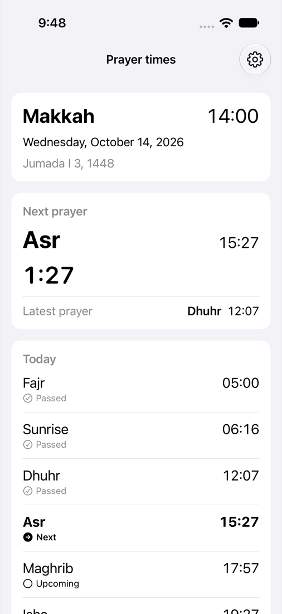
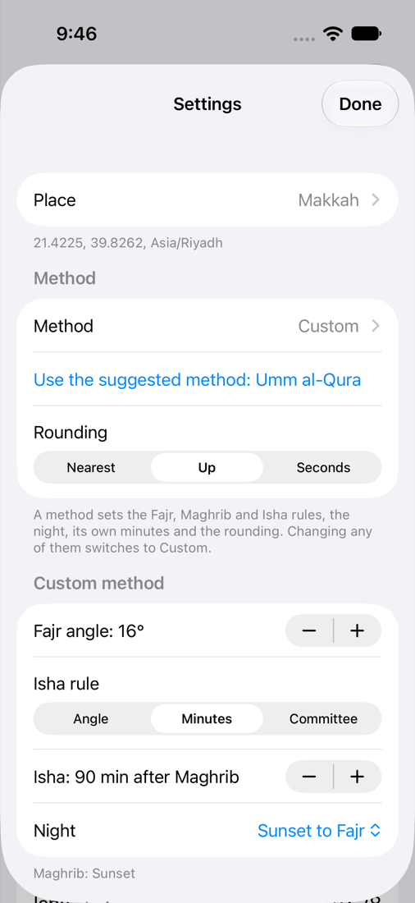
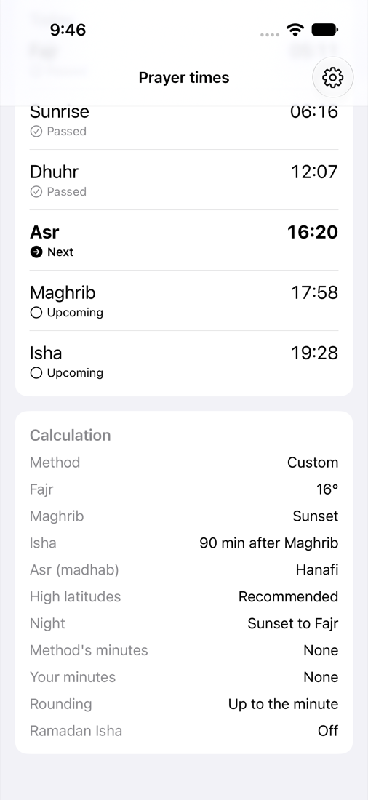
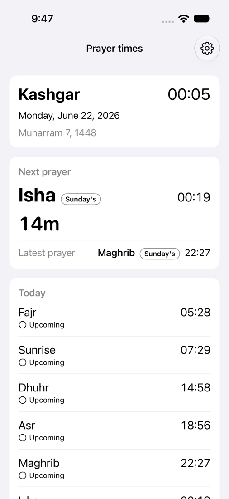
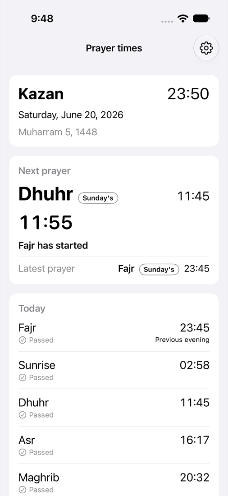
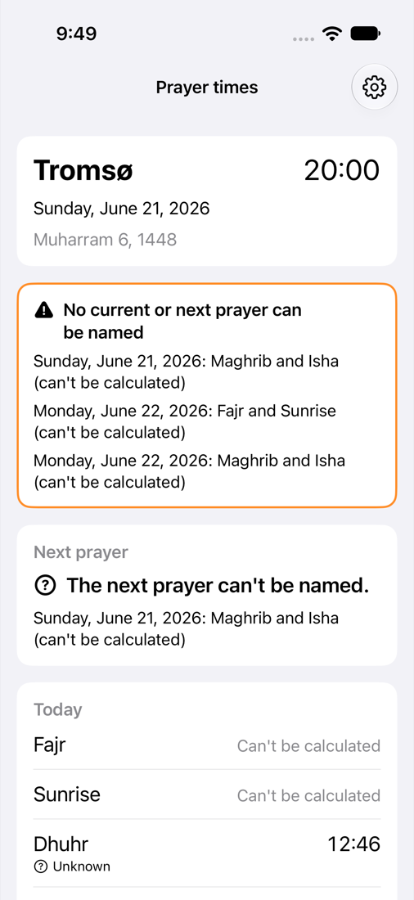
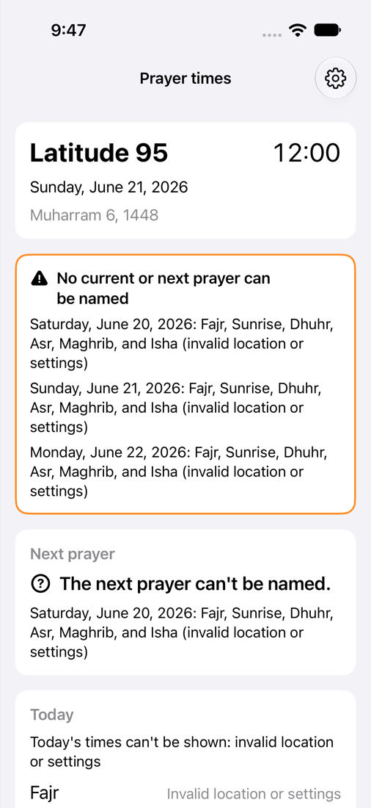
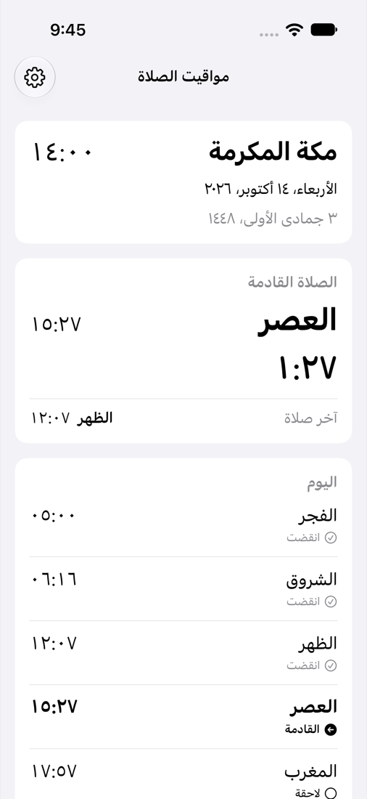

# CalculatedPhone

An iPhone app that calculates prayer times with SalahCalculation and shows them with SalahCore and SalahUI: the day's schedule, the state across midnight, every calculation parameter, and honest gaps where the calculation can't produce a time.

CalculatedPhone is SalahKit's example of a calculating app (proposal §2.3 #1). It uses only the public API of `SalahCore`, `SalahCalculation`, `SalahUI` and `SalahAlerts`, and imports `SalahTimes` to name the engine's types. It has no `@testable` imports of the packages, no internals and no copies of package logic. Its journeys run on an iPhone simulator with an injected clock and location and assert the exact text on screen.

## What it shows

One screen, and a Settings sheet:

- **Header:** the place, the local clock, and the Gregorian and Hijri dates (`HijriDateFormat`) in the place's time zone, never the device's.
- **Next prayer:** its name (`PrayerNames`), time and countdown (`PrayerDurationFormat`). When it belongs to another day's schedule, a tag says whose: just after midnight in Kashgar, the next prayer is "Isha, Sunday's". When the state can't name a next prayer, the card says so and names the gap that hides it. It never guesses.
- **Latest prayer:** the state's `latestPrayer` with its owning day, and `previous` when that's a different event (sunrise). After midnight in Kashgar the latest prayer is Sunday's Isha; at 23:50 in Kazan it's Sunday's Fajr, which falls before Sunday begins. "Fajr has started" appears inside the state's just-started window.
- **Today:** one row per expected kind of the civil day that contains "now" in the place's zone (`PrayerSchedule.day(_:)`), with the time and the status from `PrayerState.status(of:)`. A time whose instant falls on another civil date than its owning day is marked "Next day" (an Isha after midnight) or "Previous evening" (a Fajr before midnight). A kind the source can't produce shows its reason instead of a time: "Can't be calculated" (`calculationUnavailable`) or "Invalid location or settings" (`invalidData`). While the state is unavailable, statuses read "Unknown".
- **Coverage banner:** when the state is `.unavailable`, a banner lists the gaps (day, kinds and reason), current ones first. When the state is known but today is partial, the banner lists today's missing kinds. This is the app's explicit display policy: nothing is filled in from another day or another source.
- **Calculation:** every parameter of the current `CalculationSettings`: method (or Custom), Fajr rule (an angle or the Moonsighting Committee), Maghrib rule (sunset or an angle), Isha rule (an angle, minutes after Maghrib, or the Moonsighting Committee with its twilight), madhab, high-latitude rule, night span, the method's minutes, the user's minutes, rounding and the Ramadan rule.
- **Settings:** the place (six presets), the method (all 14 `CalculationMethod.allCases` and Custom, with "Use the suggested method" from `CalculationMethod.suggested(for:)`), rounding, Custom's Fajr angle, Isha rule and night span, the madhab, the high-latitude rule, the Ramadan Isha rule, a stepper per prayer for the user's minutes, and the stored JSON. Changes apply at once.
- **Prayer alerts:** Settings turns notifications on for the five prayers and offers reminders 5, 10, 15 or 30 minutes before each. The app plans up to 14 days within the system's pending-request limit and replans when it opens. The Alerts card shows permission, planned and confirmed coverage, the pending requests read back from the system, and scheduling failures.

A method defines Fajr, Maghrib and Isha, the night span, its own minutes and the rounding, so changing any of them switches to Custom and the method shown is always exact. The madhab, the high-latitude rule, the user's minutes and the Ramadan rule are the user's own and stay when the method changes (`AppSettings.choose(_:)`).

The settings (place, method choice, `CalculationSettings` and alert options) are stored as JSON in `UserDefaults` and decoded at launch; the Settings sheet shows the stored JSON. `PrivacyInfo.xcprivacy` declares the `UserDefaults` access with reason `CA92.1`. The app reads no location: a place is an explicit `PrayerLocation`.

Today's rows use `PrayerTimesList.rows`, with the partial day's missing-kind dictionary passed as `missing`. `PhoneRowStyle` reads `PrayerRowConfiguration.gapReason` to show the app's translated reason where no time exists. The same style draws known events and their statuses, and marks day offsets; it keeps the example's explicit 24-hour clock and seconds when rounding is disabled. This is the second consumer of the missing-row API in SalahKit 0.4.0, alongside Salah. The polar-night journey asserts that all six kinds stay in order and missing kinds show reasons with no status or day marker.

### Places

| Preset (`-place`) | Coordinates and zone | What it shows |
|---|---|---|
| `makkah` (default) | 21.4225, 39.8262, `Asia/Riyadh`, SA | An ordinary day; Umm al-Qura is SalahTimes' suggestion for SA |
| `london` | 51.5074, −0.1278, `Europe/London`, GB | The recommended high-latitude rule at 51° |
| `kashgar` | 39.4704, 75.9898, `Asia/Shanghai`, CN | Beijing time, two hours ahead of the Sun: summer Isha after midnight |
| `kazan` | 55.7963, 49.1088, `Europe/Moscow`, RU | A clock behind the Sun: with the middle-of-the-night rule, a summer Fajr before midnight |
| `tromso` | 69.6492, 18.9553, `Europe/Oslo`, NO | Midnight sun: Fajr, sunrise, Maghrib and Isha can't be calculated |
| `invalid` | 95, 0, `UTC` | Coordinates SalahTimes rejects: the whole day is invalid input |

## Screenshots

These are the journeys' screenshot attachments, exported from a test run on an iPhone 17 simulator with iOS 27 (`xcrun xcresulttool export attachments`) and scaled down.

| | | |
|---|---|---|
|  |  |  |
| Makkah with Umm al-Qura at 14:00: Asr is next | Settings: Custom, Fajr at 16°, rounding up | The new times and every parameter behind them |
|  |  |  |
| Kashgar, 00:05 on 22 June: the next prayer is Sunday's Isha at 00:19 | Kazan, 23:50 on 20 June: the latest prayer is Sunday's Fajr at 23:45 | Tromsø, 20:00 on 21 June: four kinds can't be calculated, and no next prayer is named |
|  |  | |
| A latitude of 95°: the whole day is invalid input, with no times | Arabic: names, Arabic-Indic digits, right to left | |

## Building and running

Open `CalculatedPhone.xcodeproj` and run the `CalculatedPhone` scheme on an iPhone simulator. Simulator builds need no signing. To run on a device, copy `Config/Local.xcconfig.example` to `Config/Local.xcconfig` and set your team there; it's gitignored.

From the command line, in this folder:

```sh
xcodegen                         # after changing project.yml; commit both files
xcodebuild test -project CalculatedPhone.xcodeproj -scheme CalculatedPhone \
  -destination 'platform=iOS Simulator,name=iPhone 17'
# The other default-isolation setting (the project defaults to MainActor):
xcodebuild build-for-testing -project CalculatedPhone.xcodeproj -scheme CalculatedPhone \
  -destination 'generic/platform=iOS Simulator' CALCULATEDPHONE_ISOLATION=nonisolated
```

Generate the project from a clone whose folder is named `SalahKit`, as CI's checkout is: XcodeGen names the local package's folder reference after the folder `../..` resolves to.

### Default isolation

The app's targets set `SWIFT_DEFAULT_ACTOR_ISOLATION` to `$(CALCULATEDPHONE_ISOLATION)`, which is `MainActor` unless a build passes `CALCULATEDPHONE_ISOLATION=nonisolated`. CI builds both. Don't pass `SWIFT_DEFAULT_ACTOR_ISOLATION` itself on the command line: a command-line build setting reaches the package targets too, makes SalahTimes' types main-actor-isolated and breaks SalahCalculation, which no app sees ([RFC 0001](../../docs/rfcs/0001-core.md) §6.3). The app's pure types (`AppSettings`, `PhoneSnapshot`, `LaunchOptions`, `CalculationText`) are `nonisolated`, so they compute off the main actor under either setting; `SettingsStore` is `@MainActor`.

### Importing SalahTimes

SalahCalculation doesn't re-export SalahTimes ([RFC 0002](../../docs/rfcs/0002-calculation.md) §3). The app names engine types (`CalculationMethod`, `Madhab`, `HighLatitudeRule`, `Rounding`, `FajrRule`, `IshaRule`, `PrayerAdjustments`, `RamadanIshaRule`), so its files `import SalahTimes`. The project links the SalahKit products `SalahCore`, `SalahCalculation`, `SalahAlerts` and `SalahUI`; the `SalahTimes` module reaches the app through SalahCalculation's dependency, and Xcode 26 and 27 accept the import without a package dependency of the app's own. A Swift package that imports SalahTimes should still list the SalahTimes product in its target, as RFC 0002 says.

### Launch arguments

`LaunchOptions` reads these. The clock and language apply to one run; the place and calculation arguments change the settings as if they were made in Settings, so they're saved. An argument whose value can't be read is ignored.

| Argument | Effect |
|---|---|
| `-now 2026-06-22T00:05:00+08:00` | Start the clock at this ISO 8601 instant; it then runs in real time |
| `-frozen` | Keep the clock at `-now` |
| `-place makkah` | A preset: `makkah`, `london`, `kashgar`, `kazan`, `tromso` or `invalid` |
| `-latitude 39.47 -longitude 75.99 -timeZone Asia/Shanghai` | A place by coordinates and IANA zone (all three needed), with optional `-countryCode CN` and `-placeName Kashi` |
| `-method ummAlQura` | A `CalculationMethod` raw value, or `custom` |
| `-madhab hanafi` | `shafi` or `hanafi` |
| `-highLatitudeRule middleOfTheNight` | A `HighLatitudeRule` raw value: `recommended`, `middleOfTheNight`, `seventhOfTheNight`, `twilightAngle` or `disabled` |
| `-rounding up` | `nearest`, `up` or `none`; switches to Custom |
| `-fajrAngle 16` and `-ishaAngle 15` | Angles in degrees; switch to Custom, starting from the current method |
| `-ramadanIsha on` | `on` or `off`: Isha 120 minutes after Maghrib in Ramadan, for an Isha set in minutes |
| `-language ar` | `en` or `ar`: UI strings, names, digits and dates. Add `-AppleLanguages (ar)` for the system's own right-to-left behavior. |
| `-resetSettings` | Start from the defaults (Makkah, Umm al-Qura), ignoring stored settings |
| `-alerts on` | `on` or `off`: save whether alerts at the five prayers are enabled |
| `-alertReminder 5` | Save a reminder offset of `5`, `10`, `15` or `30` minutes; `0` disables reminders |
| `-alertFixtureIn 180` | For this run, plan five fixture prayers starting this many seconds after launch, one minute apart |
| `-alertFixtureDay 2026-10-14` | For this run, choose the civil day that owns the fixture's prayers |
| `-failAlertAdds dhuhr,asr` | For this run, inject add failures for these prayer kinds to show unconfirmed requests and shortened coverage |
| `-probeNotificationLimit 70` | For this run, add `1`–`500` temporary requests after planning, count those the system keeps, then remove them |

## Tests

The expected times are SalahTimes 0.1.0's. They were computed once, through SalahCalculation's public API (`PrayerSchedule(source: CalculationSource(settings), location:)`, then `day(_:)` and `state(at:through:)`), in a scratch Swift package that depended on this repository and printed each day's instants in the place's zone, and they're hardcoded in the tests. The Kashgar, Kazan and Tromsø cases match RFC 0002 §4.4 and the vectors in `Vectors/calculation/`.

- `CalculatedPhoneTests` (Swift Testing) tests the app's logic below the UI: `PhoneSnapshot` at fixed instants (an ordinary day, after sunrise, after Isha, custom parameters, rounding with seconds, the Ramadan rule, user minutes, Kashgar's Isha after midnight before and after it, Kazan's Fajr before midnight, Tromsø after Asr and between Dhuhr and Asr, invalid coordinates, Arabic), the Calculation section's text for every parameter, choosing methods, the JSON round trip, `SettingsStore` saving and reloading, the launch arguments and the clock.
- `CalculatedPhoneUITests` launches the real app with a frozen clock and asserts what a person sees, through accessibility identifiers such as `row.fajr.time`, `next.countdown`, `latest.owningDay`, `coverage.gap.0` and `calc.fajr`:
  1. An ordinary day in Makkah with Umm al-Qura: the six times, statuses, the next prayer and its countdown, the latest prayer and the calculation.
  2. Custom parameters through Settings: Hanafi moves Asr to 16:19; Custom with Fajr at 16° moves Fajr to 05:10; rounding up gives 05:11, 16:20, 17:58 and 19:28; the Calculation section shows each change. Also custom angles from launch arguments.
  3. Across midnight: Kashgar at 00:05 on 22 June, where the next prayer is Sunday's Isha at 00:19, and at 00:30, where that Isha is the latest prayer. Kazan at 23:50 on 20 June, where the latest prayer is Sunday's Fajr at 23:45.
  4. Source failure: Tromsø on 21 June, where Fajr, sunrise, Maghrib and Isha can't be calculated and, after Asr, the banner explains the gap; and a latitude of 95°, where the whole day is invalid input with no times.
  5. Settings made in the app survive a relaunch without `-resetSettings`.
  6. Arabic names, Arabic-Indic digits and a right-to-left layout.
- `AlertJourneys` uses the real notification center: it enables alerts through Settings, accepts the permission alert through Springboard, checks pending-request read-back, observes a Fajr notification with the app closed, changes the fixture times, injects an add failure, then turns alerts off and probes the system's pending-request limit. It checks confirmed coverage separately from the plan's horizon. Run it with the same test command above. On the iOS 27.0 simulator, the first permission grant has sometimes left adds failing with "Source is not authorized" despite an allowed status; restarting that simulator after the grant resolved it. Keep a failed first-grant run in the evidence and report any restart separately ([RFC 0003](../../docs/rfcs/0003-alerts.md), §8).

## Accessibility and languages

Every value has a VoiceOver label, such as "At 15:27", "Time remaining: 1 hour, 27 minutes", "From Sunday's schedule" or "Method: Umm al-Qura", and every control in Settings has a label. Text uses Dynamic Type styles, rows wrap when they don't fit, and the screen scrolls. Colors are system colors, with statuses also shown by symbols and weight, not by color alone. UI strings are in `Localizable.xcstrings` in English and Arabic; the Arabic strings are machine-drafted and marked as needing review.

## Pending

- **A real iPhone:** only simulators have run the app so far. Run it on a physical iPhone, with large Dynamic Type sizes and VoiceOver.
- **Contrast decision:** `ContrastCheck` exists. The system's secondary text on white measured 3.30–3.44:1 in light mode, below WCAG's 4.5:1 for body text ([RFC 0004](../../docs/rfcs/0004-widgets-and-ui.md), §8 #6). The orange coverage-banner border measured 1.97–2.20:1, below the 3:1 non-text threshold. Choosing stronger colors remains pending; these measurements do not establish full contrast compliance.
- **Real notification delivery:** check closed-app delivery and first-permission behavior on a physical iPhone; the simulator journey does not establish device behavior.
- **Arabic review:** a native speaker should review the Arabic strings.
