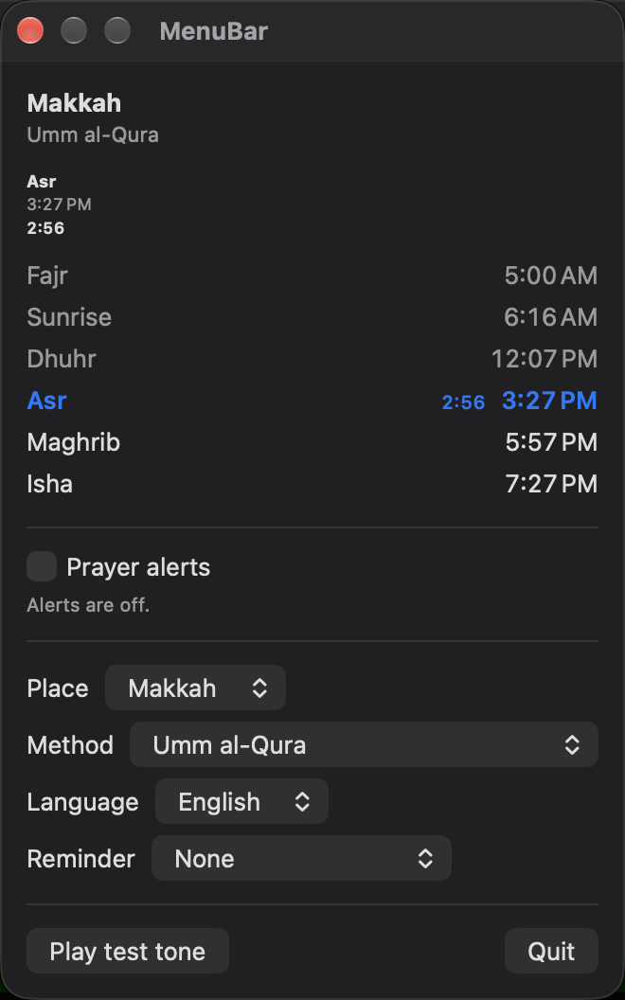
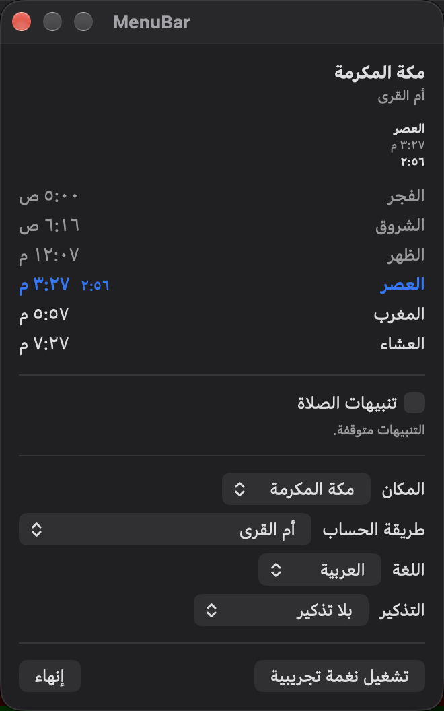
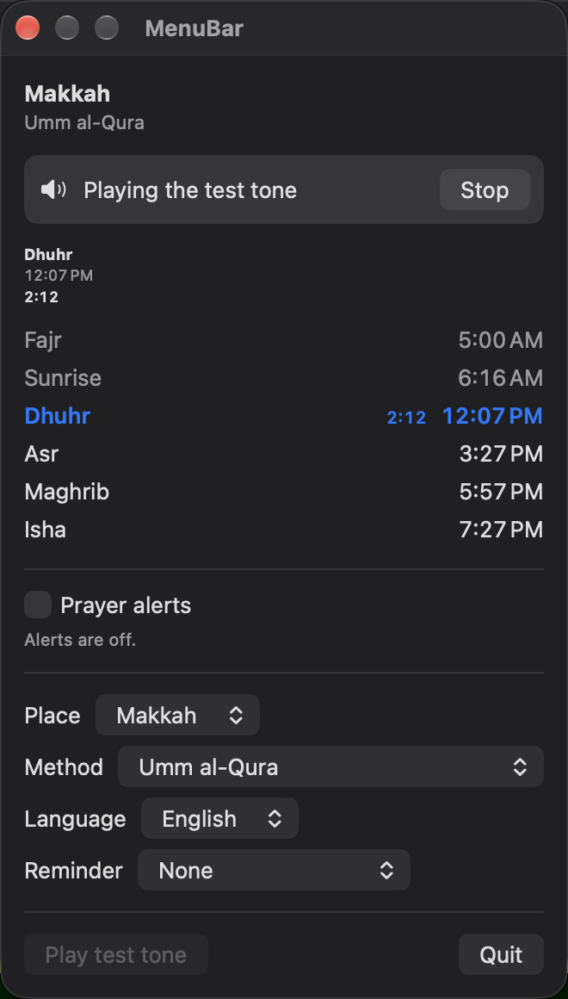

# MenuBar

A macOS menu-bar app that keeps running: the next prayer in the menu bar, refreshed at the dates of a `.steps` refresh plan; prayer alerts from SalahAlerts' in-process engine and notification plan, with a generated tone; and a desktop widget whose Stop button reaches the running app through the live-state pattern.

MenuBar is SalahKit's always-running example (proposal §11). It uses only the public API of `SalahCore`, `SalahCalculation`, `SalahAlerts`, `SalahWidgets` and `SalahUI`, and imports `SalahTimes` to name `CalculationMethod`. It has no `@testable` imports of the packages and no copies of package logic.

## What it shows

- **The display, refreshed with `.steps`.** The menu bar's title is static text. `MenuBarDisplay` plans its refreshes with `PrayerSchedule.refreshPlan(from:through:strategy:)` and `.steps(fine: 60 s, coarse: 15 min, window: 1 h)`, and `DisplayModel` arms one wake-up for the next date. Within an hour of a prayer the title counts down a minute at a time ("Asr 27m"), just after it starts it counts up ("Asr +5m"), and elsewhere it names the next prayer and its time ("Asr 15:08"). Every state change is in the plan, so the next prayer changes on time, and the display also refreshes at midnight in the place's zone, where the listed day changes without a state change. The dropdown's next prayer and day list are SalahUI's `NextPrayerView` and `PrayerTimesList` with static countdowns from the same refresh, so they change with the title. A day the calculation can't complete lists the missing times and why; a moment with no usable state says "No times".
- **Alerts for an app that keeps running.** `AlertCoordinator` follows SalahAlerts' article "Alerts within the 64-notification limit": `InProcessAlertEngine` gets the uncapped `AlertSchedule` from five minutes ago to two days ahead, `NotificationScheduler` gets the `NotificationPlan` of two weeks within the default budget of 60, and when alerts come due the engine's report goes to `deliver` (a banner for each alert the system won't show by itself) and the tone plays for `InProcessAlertEngine.preferredAlert(among:)`, the engine's default precedence. Alerts are off until the user turns them on, which asks for notification permission then. A notification for an alert whose tone the app plays carries no sound of its own, so the system doesn't play its sound beside the tone; if the app isn't running when it arrives, it's silent.
- **Sleep, wake and clock changes.** `SystemEventObserver` listens for NSWorkspace's `didWakeNotification` and for `NSSystemClockDidChange` and `NSSystemTimeZoneDidChange`. Each one makes the engine catch up (`resync()`), the alerts replan and the display plan again from the new moment. The app also replans every twelve hours.
- **A generated tone.** `ToneSynthesis` writes three soft sine notes as WAV data at launch, and `AudioTonePlayer` plays them with AVFoundation: once for the test tone, three times for an alert. No recording ships with the app.
- **The live-state pattern** (proposal §7.3, and the article "Lessons from Salah"). The app publishes what it plays in `SharedValue.nowPlaying`. The widget shows a Stop button while something plays; its `StopPlaybackIntent` runs in the widget extension's process, clears the value and posts `MenuBarID.stopSignal`, a `DarwinSignal`. `LiveState` stops the tone when the signal arrives, without reading the stored value, and publishes what it plays again, which confirms the stop to the widget.
- **The widget.** Small and medium families for the desktop and Notification Center. The extension loads the settings and what plays from the App Group and builds a `.steps` timeline with `PrayerTimelineBuilder` (static text, a minute grid within 30 minutes of a prayer), plus an entry at each midnight; without settings it asks the user to open the app.

### The app

- **Place:** Makkah (the default), Istanbul, London and Tromsø (partial days around midsummer).
- **Method:** Umm al-Qura, Muslim World League, Egyptian, Diyanet and ISNA.
- **Language:** English or Arabic, for the names, the title, the notifications and the widget, whatever the Mac's language; right to left in Arabic.
- **Alerts:** on or off, a reminder 5 to 30 minutes before each prayer or none, and whether the app plays its tone. The dropdown says how many alerts the engine follows and until when the system's notifications are confirmed.
- **Play test tone** and **Quit**.

## Screenshots

These are the journeys' screenshot attachments, exported from a test run on this Mac (macOS 27) with `xcrun xcresulttool export attachments`. The journeys read the dropdown's view in a window (`-showWindow`), because macOS can hide a status item behind the camera housing.

| | | |
|---|---|---|
|  |  |  |
| Makkah at 12:30 on 14 October 2026: Asr next, alerts off | Arabic names and digits, right to left | The test tone plays, with the app's Stop button |

## App Group and signing

The app, the widget extension and the stop harness share the App Group `group.io.github.salah-kit.MenuBar`, and all three are sandboxed (WidgetKit runs only sandboxed extensions on macOS). On macOS an App Group named `group.…` must be authorized by a provisioning profile, so running the app needs a signing team:

1. Copy `Config/Local.xcconfig.example` to `Config/Local.xcconfig` (gitignored) and set your team.
2. Build with `-allowProvisioningUpdates`, or let Xcode manage signing: it registers the three bundle identifiers (`io.github.salah-kit.MenuBar`, `.MenuBar.Widgets`, `.MenuBar.StopHarness`) and the App Group.

CI builds and tests unsigned (`CODE_SIGNING_ALLOWED=NO`): without entitlements nothing is sandboxed, and the app and the harness share the App Group's suite as plain preferences. The unit tests and the journeys run the same way; the signed run proves the sandboxed path.

## Building and testing

From this folder, with your team in `Config/Local.xcconfig`:

```sh
xcodegen                        # after changing project.yml; commit both files
xcodebuild test -project MenuBar.xcodeproj -scheme MenuBar -destination 'platform=macOS' \
  -allowProvisioningUpdates
# As CI does, unsigned:
xcodebuild test -project MenuBar.xcodeproj -scheme MenuBar -destination 'platform=macOS' \
  CODE_SIGNING_ALLOWED=NO
# The other default-isolation setting (the project defaults to MainActor):
xcodebuild build-for-testing -project MenuBar.xcodeproj -scheme MenuBar \
  -destination 'platform=macOS' MENUBAR_ISOLATION=nonisolated CODE_SIGNING_ALLOWED=NO
```

The journeys need macOS UI testing: `xcodebuild` turns on Automation Mode, which may ask for an administrator's password unless it's set to need none (`automationmodetool`).

### Default isolation

The app's targets default to `MainActor` isolation, as new Xcode projects do. `MENUBAR_ISOLATION` sets it for the example's own targets only, so the package's targets build as they do in any app. The shared settings, what plays, the intent, the widget's provider and entry are `nonisolated`, because the widget extension and the scheduler use them off the main actor.

### Launch arguments

| Argument | Effect |
|---|---|
| `-now <ISO 8601 instant>` | Start the app's clock at this instant; it then runs in real time. The widget extension always uses the real clock. |
| `-place makkah\|istanbul\|london\|tromso`, `-method <name>`, `-language en\|ar` | Change the settings, as the dropdown does; they're saved. |
| `-alerts on\|off`, `-reminder 5\|10\|15\|30\|off`, `-tone on\|off` | Turn alerts on or off, set the reminder, and choose whether the app plays its tone; saved. |
| `-notifications memory` | Use an in-memory notification center: no permission prompt, nothing in Notification Center. |
| `-muted` | Play the tone at zero volume. |
| `-playTestTone once\|repeating` | Start the test tone at launch, once or until stopped. |
| `-showWindow` | Open the dropdown's view in a window. |
| `-testEvents` | Let the stop harness simulate a sleep and a clock change (below). |

### Tests

- **Unit tests** (`MenuBarTests`, Swift Testing, hosted by the app, which stays inert while it hosts them):
  - `DisplayTests`: the title's wording far from a prayer, within its hour, just after it and with no usable state, in English and Arabic; the refreshes of a `.steps` plan with a manual clock (every 15 minutes, then every minute on the prayer's minutes for an hour either side, each title exact at its refresh); the midnight refresh; a replan after a jump in time.
  - `LiveStateTests`: publishing what plays and gating the widget's reloads; the stop signal stopping the tone and republishing; the signal with a stored value that still says the tone plays (the app stops, and its republish clears the value); a cleared value without the signal (nothing stops); a tone that ends by itself or can't start.
  - `AlertCoordinatorTests`: the engine gets the uncapped two-day schedule and the scheduler the 60-request plan; with a budget of two, a reminder the plan left out still comes due, gets a banner through `deliver` and plays the tone; two alerts due together play the one the engine's precedence picks; a wake posted to an injected NSWorkspace center after a sleep through Asr catches it up, replans, and then posts Asr's banner although its request was still pending (the banner goes out after the replan's apply, which removes the past request); a clock change posted to an injected center within the five-minute grace catches up with a banner and beyond it skips; a time zone change replans; alerts off empties the engine and removes the requests; the twelve-hour replan; the notifications' wording and sounds.
  - `WidgetTimelineTests`: the setup entry; the `.steps` timeline with its minute grid, its expired entry and its midnight entries; the Stop button on every entry while a tone plays; the intent's work (clear, reload, signal).
  - `ToneTests` and `LaunchOptionsTests`: the WAV data and the arguments; `-reminder` takes only the reminders the dropdown offers.
- **Round trip** (`MenuBarRoundTripTests`, Swift Testing, no host app): each test starts the real app with launch arguments and drives the stop harness, each in its own process. These tests run in `xctest`, outside any sandbox; XCUITest's runner is sandboxed and can't start the harness.
  - The stop round trip (below).
  - The signal alone: the harness posts only the signal, leaving the stored value saying the tone plays; the app stops, and its republish clears the value (`changed=true`).
  - A wake after sleeping through a prayer: launched a minute before Asr with alerts on and `-testEvents`, the app is asked by the harness's `sleep` to move its clock three minutes ahead and post NSWorkspace's wake notification to itself. Its log then has the wake, the display planned again ("Asr +2m"), Asr's alert started after the wake, and a replan.
  - A clock change beyond the grace: the harness's `clock` moves the app's clock ten minutes ahead and posts `NSSystemClockDidChange`; the display shows "Asr +9m", the alerts replan, and nothing plays.
- **Journeys** (`MenuBarUITests`, XCUITest, on this Mac):
  - `testScheduleShowsTheDay` and `testArabic`: the window lists Makkah's day, in English or Arabic, and the status item names the next prayer.
  - `testTitleRefreshesOnTheMinute`: launched three seconds before Asr, the status item's title turns to "Asr started 0 seconds ago" at Asr and to "Asr started 1 minute ago" a minute later, with nothing touching the app. (XCUITest reads the title's spoken label, which the app sets from the same refresh as the text "Asr +0s".)
  - `testAppStopButton`: the window's "Play test tone" shows what plays, and its Stop button ends it.
  - `testToneToggle`: "Play the app's tone" turns off and on again, and is disabled once alerts are off.

## The stop round trip

A tap on a desktop widget can't be automated, so the stop harness stands in for the widget extension. `MenuBarStopHarness` is a background-only app bundle with the same sandbox and App Group as the extension, so it can carry the App Group's provisioning profile. It compiles the same shared files and runs `StopPlaybackIntent().perform()`, the intent's own code. Each command prints one line of JSON:

```sh
H=<products>/MenuBarStopHarness.app/Contents/MacOS/MenuBarStopHarness
"$H" stop      # runs the intent: clears the stored value and posts the stop signal
"$H" signal    # posts only the signal, as if the cleared value hadn't reached the app
"$H" state     # what's stored: what plays, the app's log, the widget's timeline from them
"$H" sleep     # with -testEvents: three minutes of simulated sleep, then a wake
"$H" clock     # with -testEvents: the clock set ten minutes ahead
```

The app records what it does with playback, the stop signal and system events in a bounded log in the App Group (`DiagnosticsLog`, the example's evidence channel), and in the unified log under the subsystem `io.github.salah-kit.MenuBar`. `MenuBarRoundTripTests` runs the round trip against the running app: the app plays and the widget's timeline shows the Stop button; after `stop`, the app's log has `stopSignal`, `stopped signal wasPlaying=true` and `published playing=false`, the stored value is gone, and the widget's timeline, built by the extension's code in the harness's process, no longer shows the button.

On this Mac (macOS 27, Xcode 27.0), signed with a personal team, the app and the harness ran sandboxed with the App Group, and the Darwin signal reached the app from the harness's sandbox with no prompt.

## Accessibility and languages

The Stop buttons are labelled "Stop the tone" (the widget's names the prayer: "Stop the tone for Asr"); the title has a spoken label ("Asr in 27 minutes"); SalahUI's rows read as one element with the full name. The dropdown and the widget use the system's text styles. Every string is in the String Catalog (`Shared/Localizable.xcstrings`), in English and Arabic; the Arabic is machine-drafted and marked as needing review, and the prayer names come from SalahCore's reviewed catalog.

## Pending

These need a person, a real desktop or real sleep, and are recorded in `reports/evidence/`:

- **A real tap on the desktop widget's Stop button** (`reports/evidence/D2-menubar-widget-stop.md`): the harness runs the intent's code in a separate sandboxed process, not in the widget extension that WidgetKit launches.
- **Real sleep and wake** (`reports/evidence/D2-menubar-sleep-wake.md`): the round-trip tests make the app post the wake notification to itself; a real sleep also stops the app's timers, and the system decides when an overdue notification request is delivered.
