# MosqueBoard

A board for an iPad and for a mosque's Apple TV that shows the mosque's published prayer and iqama times with SalahCore, and calculates nothing.

MosqueBoard is SalahKit's example of a published-timetable app. Both apps import only `SalahCore`. No SalahTimes or SalahCalculation code is in their source or their build graphs, and CI checks that the apps link neither. Where the timetable has a hole, the board says so instead of inventing a time.

## What it shows

One screen, in landscape and portrait on the iPad:

- **Header:** the mosque, the local clock, and the Gregorian and Hijri dates in the mosque's time zone (`HijriDateFormat`).
- **The day's prayers:** a row per expected kind of the current calendar day (`PrayerSchedule.day(containing:)`). Each row has the name (`PrayerNames`, Jumu'ah only when the event declares it), the begin time, the iqama time and the status from `PrayerState.status(of:)`: passed, started, next (or next and soon) and upcoming. While the state is unavailable the status reads "Unknown": the schedule can't say which prayer is current. A missing time shows why it's missing, such as "Not published". A time after midnight is marked "Next day", and so is an iqama after midnight when its prayer begins before it.
- **The next prayer:** its name, begin time and countdown (`PrayerDurationFormat`). If the next prayer belongs to the previous day's timetable (an Isha after midnight), the panel says so. If the timetable has nothing after the latest prayer, the panel says the next prayer isn't published yet.
- **The coverage banner:** when the state is unavailable, the board names neither a current nor a next prayer. It lists each `ScheduleGap` instead: the day, the missing kinds and the reason.

The board redraws every second, which drives the countdown and also catches every state change (`ScheduleState.changesAt`) within a second. Times use a 24-hour clock with the language's digits (`PrayerLocale.resolved`).

### On Apple TV

The tvOS app shows the same board from the same code, with the same launch arguments. What differs:

- The TV is always landscape, so the next-prayer panel always sits beside the table, on the left in Arabic.
- The whole board fits inside the TV's safe area. Nothing on the board takes focus, so it can't scroll. tvOS's text styles are already sized for reading across a room, so the TV uses smaller styles than the iPad, and a 120-point countdown. The tallest board, every night from Isha to its iqama ("Isha has started", the next Fajr and the timetable it comes from), sets the TV's sizes.
- The screen saver stays off while the app is open (`isIdleTimerDisabled`), because nobody touches a mosque's TV.
- tvOS has no Dynamic Type setting and no system background colors, so the TV draws on its own background with translucent panels.

## The code

| Folder | What it holds | Built into |
|---|---|---|
| `Shared/` | The app, the board's logic (`Board`, `BoardSnapshot`), its view, the String Catalog and the two timetables | Both apps |
| `MosqueBoardTV/` | `TVAppDelegate`, which keeps the screen saver off | The tvOS app |
| `MosqueBoardTests/` | Unit tests of the shared logic | Both unit-test bundles |
| `MosqueBoardTVTests/` | A unit test of what only the tvOS app does | The tvOS unit-test bundle |
| `MosqueBoardUITests/`, `MosqueBoardTVUITests/` | The iPad and the tvOS journeys | One UI-test bundle each |
| `JourneySupport/` | How the journeys launch the board and read it | Both UI-test bundles |

The only platform differences in the shared code are the layout's sizes and colors (`BoardStyle` in `Shared/BoardView.swift`) and the tvOS app delegate. The tvOS target's product and module are named `MosqueBoard`, like the iPad app's, so the same unit tests import it, and both apps use the bundle identifier `io.github.salah-kit.MosqueBoard`, as one App Store app for iPad and Apple TV would.

## The data

Two timetables in SalahKit's `TimetableSource` JSON. [Timetables.md](Timetables.md) describes how each file was made, and `Scripts/check-timetables.py` checks them.

| Board | Timetable | Zone | Iqama and Jumu'ah |
|---|---|---|---|
| `muis` | MUIS's Muslim Prayer Timetable 2026 for Singapore: real, published data, 2026-01-01 to 2026-12-31 | `Asia/Singapore` | **App policy** (below) |
| `edinburgh` | **Synthetic** timetable for a fictional mosque in Edinburgh, 2026-03-01 to 2026-10-31, with a partial row (2026-06-24), a missing day (2026-06-26), Isha after midnight in summer and both 2026 clock changes | `Europe/London` | Published in the timetable |

Contains information from Muslim Prayer Timetable 2026 accessed on 2026-10-13 from data.gov.sg (Majlis Ugama Islam Singapura) which is made available under the terms of the Singapore Open Data Licence version 1.0 https://data.gov.sg/open-data-licence

The MUIS board shows the same sentence in its footer, in English in both languages because it's a licence notice. Neither MUIS nor data.gov.sg endorses this app.

### App policy on the MUIS board

MUIS publishes begin times only: no iqama and no Jumu'ah. The board adds both as this mosque's own settings, and its footer says so. In the code, both are in `Shared/Board.swift`:

- `Board.muisIqama`, an `IqamaRules`: Fajr 20 minutes after it begins, Dhuhr, Asr and Isha 10, Maghrib 5, and Jumu'ah 30 minutes after Dhuhr begins.
- `DeclaredJumuahSource`, a small `PrayerSource` that wraps the `TimetableSource` and declares `.jumuah` on every Friday's Dhuhr. SalahCore never infers Jumu'ah from the weekday, so the app declares it. The published times pass through unchanged.

The Edinburgh timetable publishes its own iqama and declares Jumu'ah on every Friday, so that board uses the timetable as it is.

## Screenshots

These are the journeys' screenshot attachments. The iPad ones were exported from a test run on an iPad (A16) simulator with iOS 27 (`xcrun xcresulttool export attachments`) and scaled down. XCUITest stores landscape screenshots as portrait pixels with an EXIF orientation, so the two landscape ones were turned upright (`sips -r 270`) and their metadata removed.

| | |
|---|---|
| 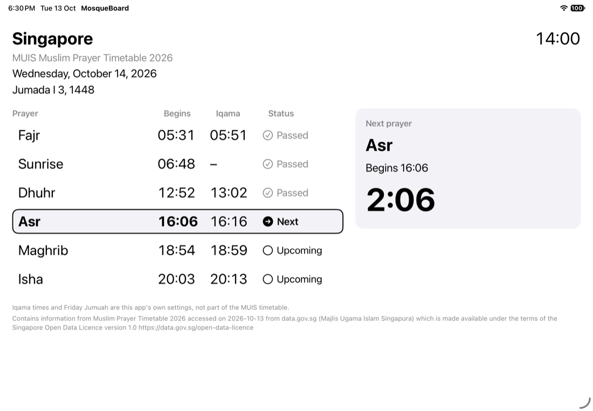 | 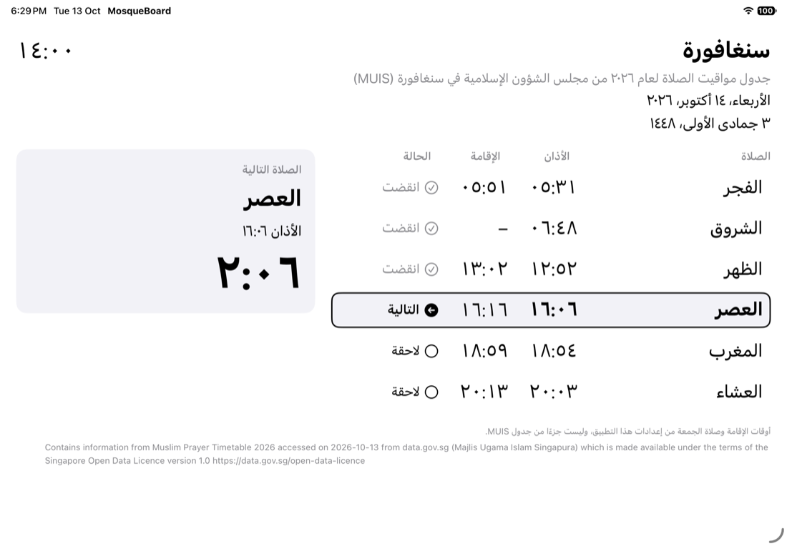 |
| A normal MUIS day: iqama from the app's rules, passed rows, Asr next | Arabic: names, Arabic-Indic digits, right to left |
| 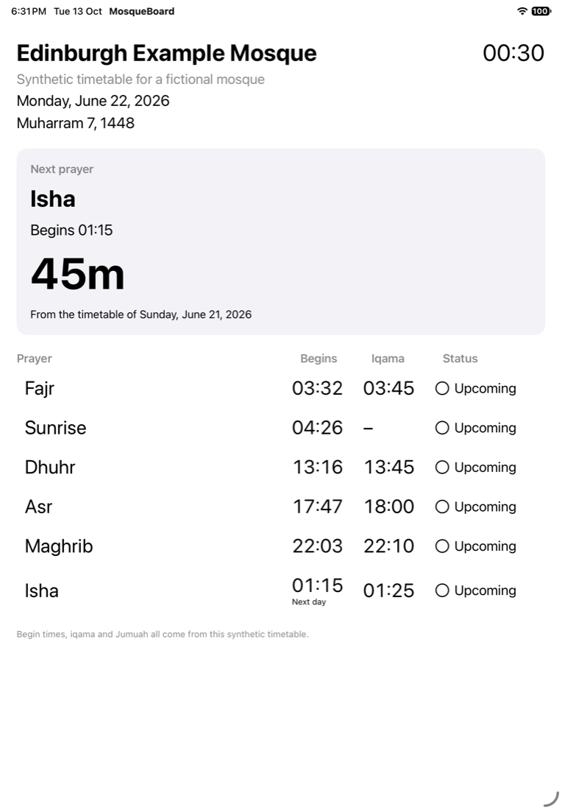 | 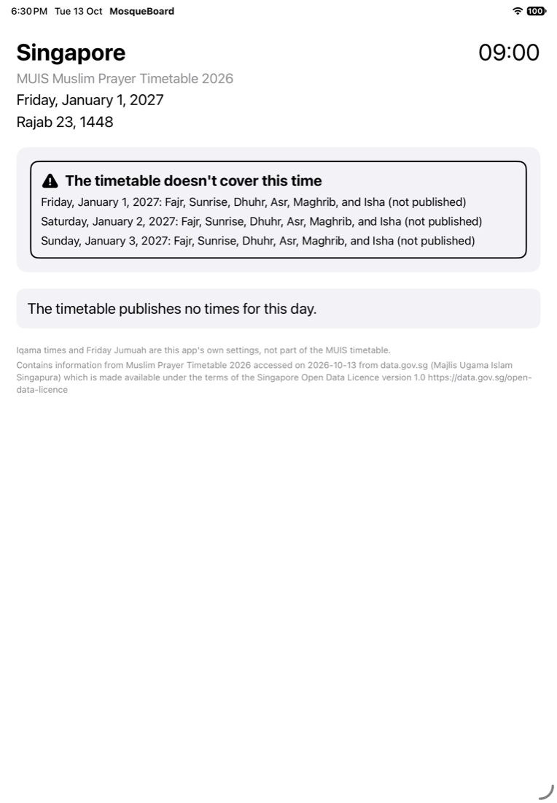 |
| 00:30 on 22 June: the next prayer is 21 June's Isha at 01:15 | 1 January 2027: the MUIS timetable has ended |
| 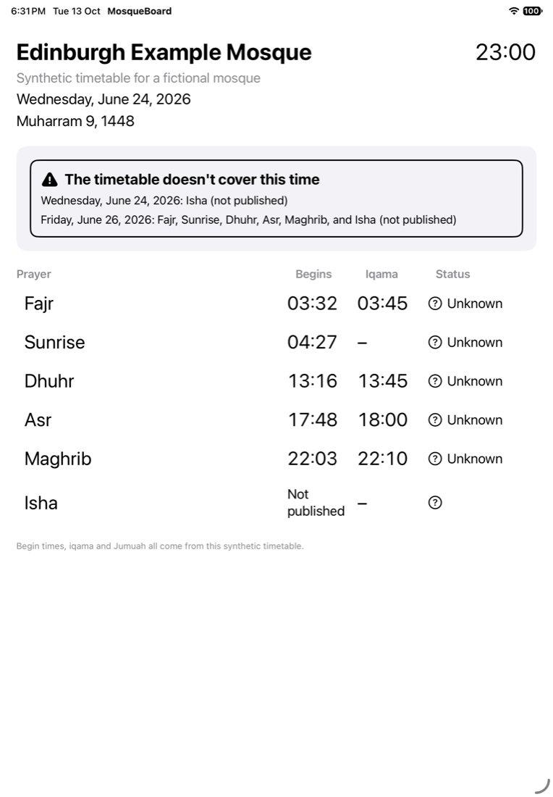 | |
| 23:00 on 24 June: Isha isn't published, so the board names no next prayer | |

### On Apple TV

These come from the tvOS journeys on an Apple TV 4K (3rd generation) (at 1080p) simulator with tvOS 27, exported the same way, scaled down from 1920 × 1080 and quantized with `pngquant`.

| | |
|---|---|
| 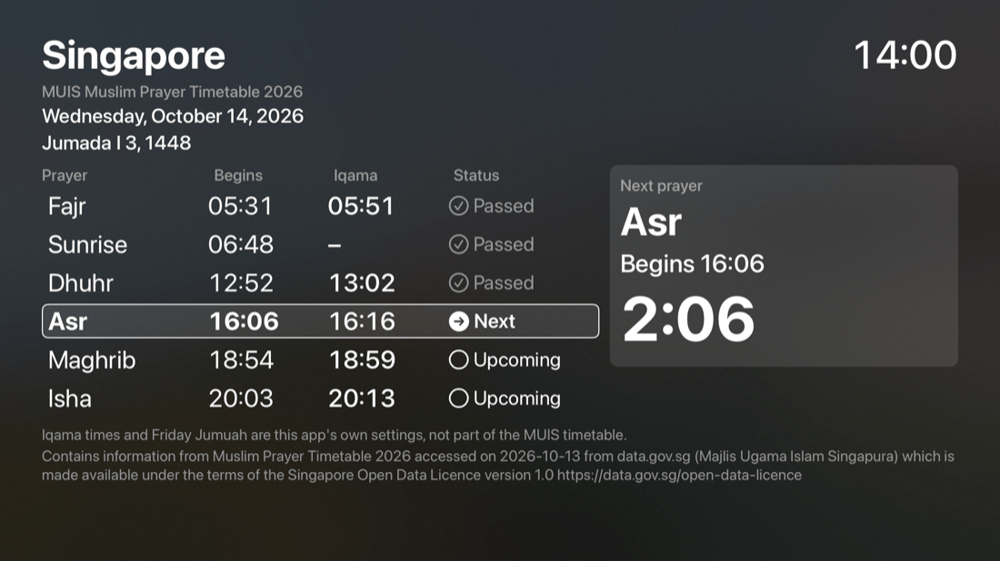 | 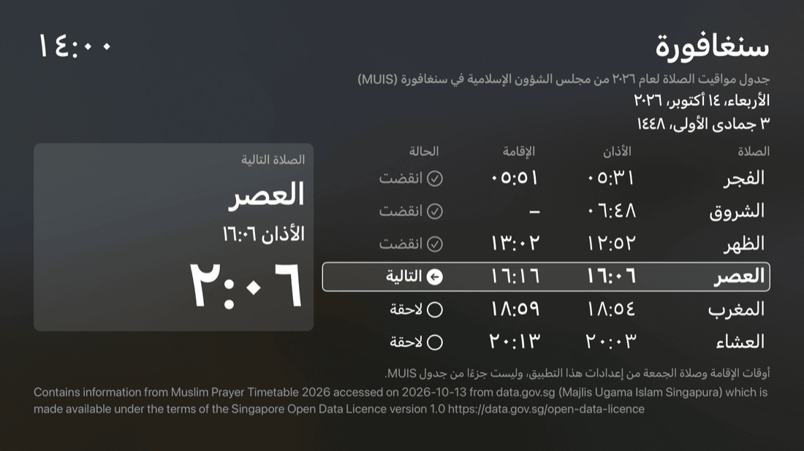 |
| A normal MUIS day | Arabic, right to left |
| 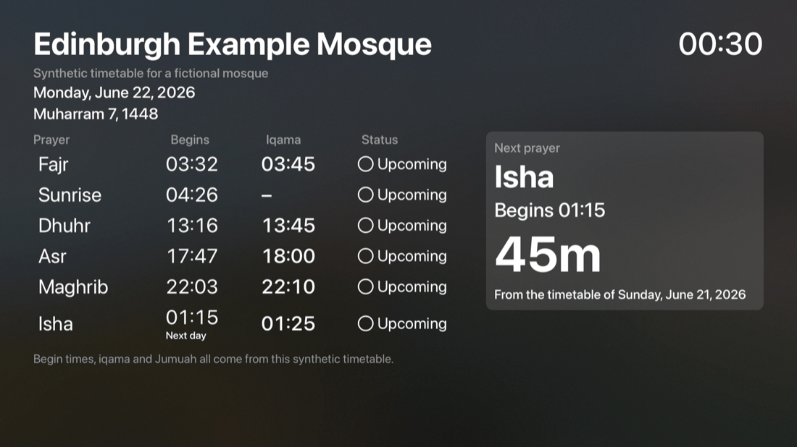 | 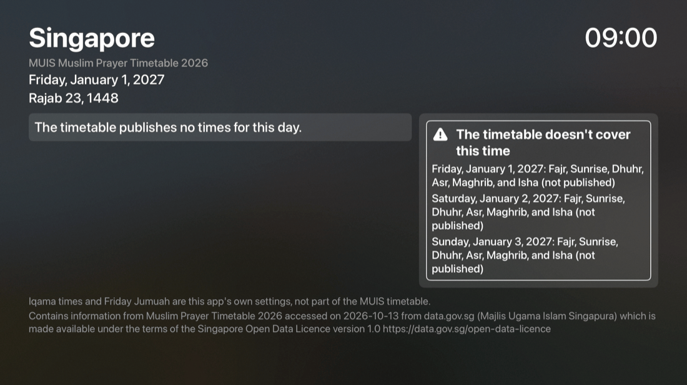 |
| 00:30 on 22 June: the next prayer is 21 June's Isha | 1 January 2027: the MUIS timetable has ended |
| 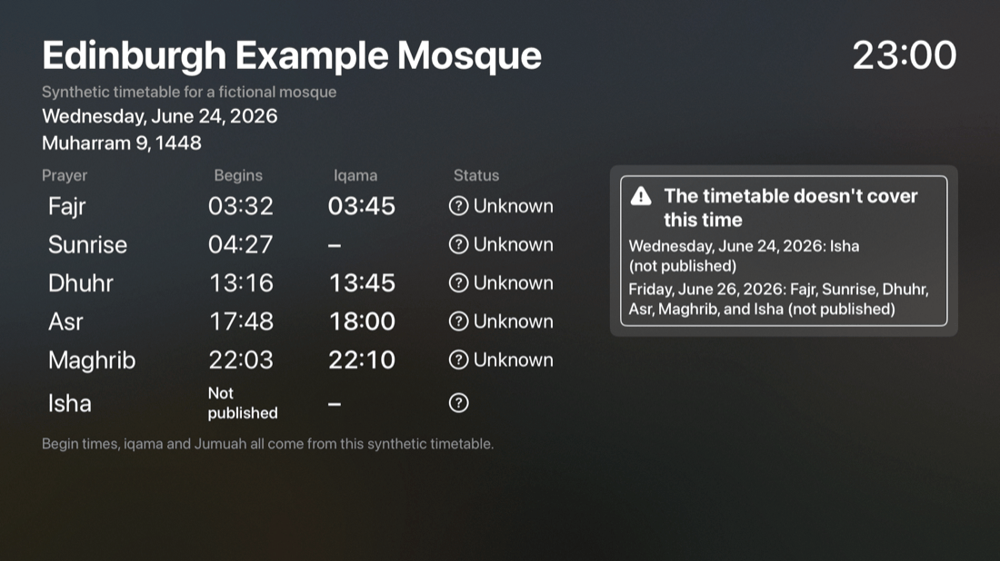 | 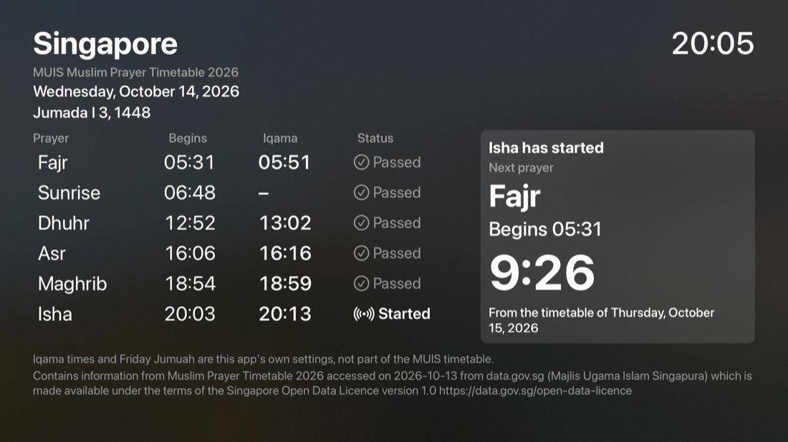 |
| 23:00 on 24 June: no next prayer is named | |

## Building and running

Open `MosqueBoard.xcodeproj` and run the `MosqueBoard` scheme on an iPad simulator, or the `MosqueBoardTV` scheme on an Apple TV simulator. Simulator builds need no signing. To run on a device, copy `Config/Local.xcconfig.example` to `Config/Local.xcconfig` and set your team there; it's gitignored.

From the command line, in this folder:

```sh
xcodegen                         # after changing project.yml; commit both files
xcodebuild test -project MosqueBoard.xcodeproj -scheme MosqueBoard \
  -destination 'platform=iOS Simulator,name=iPad (A16)'
# The other default-isolation setting (the project defaults to MainActor):
xcodebuild build -project MosqueBoard.xcodeproj -scheme MosqueBoard \
  -destination 'generic/platform=iOS Simulator' SWIFT_DEFAULT_ACTOR_ISOLATION=nonisolated
# The tvOS app, the same way:
xcodebuild test -project MosqueBoard.xcodeproj -scheme MosqueBoardTV \
  -destination 'platform=tvOS Simulator,name=Apple TV 4K (3rd generation)'
xcodebuild build -project MosqueBoard.xcodeproj -scheme MosqueBoardTV \
  -destination 'generic/platform=tvOS Simulator' SWIFT_DEFAULT_ACTOR_ISOLATION=nonisolated
python3 -I Scripts/check-timetables.py
```

### Launch arguments

| Argument | Effect |
|---|---|
| `-board muis` or `-board edinburgh` | The timetable and location to show (default `muis`) |
| `-now 2026-06-22T00:30:00+01:00` | Start the board's clock at this ISO 8601 instant; it then runs in real time |
| `-frozen` | Keep the clock at `-now` |
| `-language ar` | Names, digits and dates in Arabic. Add `-AppleLanguages (ar)` for the system's own right-to-left behavior. |

Both apps take the same arguments. They read no location and store nothing, so they need no permissions and no privacy manifest.

## Tests

- The unit tests in `MosqueBoardTests/` (Swift Testing) run in both unit-test bundles: `MosqueBoardTests` on iPad and `MosqueBoardTVTests` on Apple TV. They decode both timetables with `TimetableSource` and check every day: MUIS's 365 complete days, and Edinburgh's partial row, missing day, overnight Isha, clock changes and Fridays. They also test the board's logic at fixed instants and in Arabic, the app-policy Jumu'ah, and the launch arguments.
- `MosqueBoardUITests` launches the real app with a frozen clock and asserts what a person sees, through accessibility identifiers such as `row.fajr.time`, `next.countdown` and `coverage.banner`:
  1. A normal MUIS day with the app's iqama, a passed row, the next row and the countdown.
  2. Jumu'ah on a MUIS Friday, by app policy, and Dhuhr on the Thursday before.
  3. Expired coverage: after the last Isha of 2026 the next prayer isn't published; on 1 January 2027 the banner explains the gap.
  4. Isha at 01:15: the countdown runs across midnight, and after midnight the board shows 22 June while the next prayer is 21 June's Isha. On 30 April, Isha begins at 23:48 and its iqama at 00:00 is marked "Next day".
  5. Countdowns across the 2026 spring-forward and fall-back count elapsed time.
  6. The partial row and the missing day show the banner, never invented times.
  7. Arabic names, Arabic-Indic digits and a right-to-left layout.
  8. The largest accessibility text size, in both orientations and both languages, on the MUIS board and on Edinburgh's partial row: every name, time and status is inside the window and at least as wide as its widest word, and VoiceOver reads the table in one piece, each row's times before its status.
- `MosqueBoardTVTests` also checks that the tvOS app keeps the screen saver off.
- `MosqueBoardTVUITests` runs the iPad journeys' cases on Apple TV with the same instants and expectations: the normal MUIS day, Jumu'ah on a Friday, the expired timetable's banner, Isha after midnight, the partial row and Arabic, plus the tallest board (Isha just started, in English and Arabic). Because a TV board can't scroll, each also checks that the footer ends inside the safe area, and the normal day checks that the countdown isn't shrunk to fit.

## Accessibility and languages

Every value on the board has a VoiceOver label, such as "Begins 05:31", "Iqama 05:51", "No iqama", "Passed" or "Time remaining: 2 hours, 6 minutes". VoiceOver reads each row's name and times before its status, and in landscape reads the next-prayer panel, or the coverage banner, before the table rather than between its rows. Text uses Dynamic Type styles, and the iPad board scrolls when it's too large to fit. At the accessibility text sizes the table's columns would leave the names no room, so each row stacks its name, times and status, the next-prayer panel goes above the table in landscape too, and the clock goes below the mosque's name when both don't fit on one line. tvOS has no Dynamic Type setting; its text styles have fixed sizes, and the TV board fits on one screen. Colors are system colors: primary text on the system background (the TV's own background on tvOS), with statuses also shown by symbols and weight, not by color alone. UI strings are in `Localizable.xcstrings` in English and Arabic. The Arabic strings are machine-drafted and marked as needing review.

## Pending

- **Contrast limit:** the example retains platform semantic secondary text, following [RFC 0004](../../docs/rfcs/0004-widgets-and-ui.md), §8 #6. The recorded light-mode ratio of 3.30–3.44:1 is below WCAG's 4.5:1 for body text; apps requiring that floor must restyle it. The iOS measurements do not establish full contrast compliance or measure the TV's own background.
- **A real iPad:** only simulators have run the board so far: both orientations, the largest text sizes and Arabic ([#26](https://github.com/salah-kit/SalahKit/issues/26)), and VoiceOver ([#30](https://github.com/salah-kit/SalahKit/issues/30)).
- **A real Apple TV:** only a simulator has run the tvOS app so far: the TV's overscan, the screen saver and reading the board from across a room ([#27](https://github.com/salah-kit/SalahKit/issues/27)).
- **Arabic review:** a native speaker should review the Arabic strings ([#35](https://github.com/salah-kit/SalahKit/issues/35)).
- **Local-source meaning:** see "Source interpretation" in [Timetables.md](Timetables.md).
