# PhoneWidgets

An iPhone app and a widget extension that share an App Group. The app saves the place, the calculation method and the names' language; the extension builds its own schedule with SalahCalculation and its own 48-hour timeline with SalahWidgets, and draws it with SalahUI on the Home Screen and the Lock Screen. Nothing depends on the app running after it saves.

PhoneWidgets is SalahKit's widget example (proposal §11). It builds on [CalculatedPhone](../CalculatedPhone)'s calculated integration and stays small. It uses only the public API of `SalahCore`, `SalahCalculation`, `SalahWidgets` and `SalahUI`, and imports `SalahTimes` to name `CalculationMethod`. It has no `@testable` imports of the packages and no copies of package logic.

## What it shows

- **One file of settings, two processes.** `WidgetSettings` (the place, `CalculationSettings`, the method and the language) is `Codable`, `Equatable` and `Sendable`, stored with `SharedValue` under the versioned key `settings.v1` in the App Group `group.io.github.salah-kit.PhoneWidgets`. The app is its only writer.
- **Reload gating.** Every change goes through `SharedValue.save(_:reloading:)` with the widget's kind, which asks WidgetKit for a reload only when the stored value changed. The app shows the answer for each save: "Save 3: changed, widget reload requested." or "Save 4: unchanged, no reload requested.", and has a button that saves the same settings again.
- **The timeline in the extension.** `PrayerTimelineProvider.timeline(settings:now:)` is a pure function the extension's `TimelineProvider` calls and the tests call with a fixed clock. Without settings it returns one setup-required entry that never reloads. With settings it builds `PrayerSchedule(source: CalculationSource(…), location:)` and `PrayerTimelineBuilder` with `.stateChanges` over the default 48-hour horizon: an entry wherever the state changes, the timeline-expired entry at `validUntil`, and a reload halfway there. It adds an entry at each midnight in the place's zone, with the state that holds then, so the listed day turns over with the date.
- **A dynamic countdown.** The countdown is SalahUI's live one, `Text(timerInterval:)`, so the timeline needs entries only where the state changes.
- **The app's own words for every state** (`WidgetDisplay` and `WidgetWording`):

| State | When | What the widget says |
|---|---|---|
| Setup required | No settings in the App Group | "Choose a place. Open PhoneWidgets to choose a place." |
| Normal | The schedule knows the next prayer | The next prayer, its time and countdown, and the day's times |
| Partial | The schedule knows some times but not all | The known times and the app's note: on Tromsø's midsummer days, "Fajr, Sunrise, Maghrib, and Isha: can't be calculated today." with the countdown to the known next prayer; when the next prayer itself is unknown, "Next prayer unknown" in its place and no countdown |
| Unavailable | The schedule knows nothing usable now | "No prayer times", and why: "Prayer times can't be calculated here today." or "The place or the settings aren't valid." |
| Expired | The timeline ran out before WidgetKit asked for a new one | "Times need refreshing. Known until …. Open PhoneWidgets to refresh."; no countdown |

Times are always in the place's time zone, whatever the device's, because SalahUI's components format them in the zone they're given. In the extension the countdowns are live; where the app draws an entry of a fixed moment (Widget states, the preview), they show the time left at the entry's date (`PrayerCountdown.Mode.staticText`), because a live timer counts from the real clock.

### Widget families

| Family | Content |
|---|---|
| `systemSmall` | The place and `NextPrayerView` with the app's card style: the just-started prayer, the next prayer's name and time, the live countdown |
| `systemMedium` | The card, and the day's `PrayerTimesList` with the app's row style |
| `systemLarge` | The card, the day's list, and the note for anything unknown |
| `accessoryCircular` | `NextPrayerView` with a circular style: the next prayer's abbreviation over its countdown; VoiceOver reads the full name |
| `accessoryRectangular` | The next prayer's name and time, then the countdown or the note |
| `accessoryInline` | The next prayer and its time on one line |

The setup, unavailable and expired states replace these with a symbol and the app's words in every family.

### The app

- **Place:** Makkah (the default when setting up), London, Tromsø (partial days around midsummer) and invalid coordinates (a latitude of 95°, for the unavailable view).
- **Method:** Umm al-Qura, Muslim World League, Egyptian, ISNA and Karachi.
- **Language:** English or Arabic, for the widget's names and words whatever the phone's language. The app follows it too, right to left in Arabic.
- **Widget states:** every state above, in every family, drawn with the extension's own view code (`PrayerWidgetView`) from entries made by the extension's own provider function. The partial day is Tromsø at 15:00 on 21 June 2026, between Dhuhr and Asr; the others use the app's clock. A calculation knows its next prayer whenever it knows anything (after Asr in Tromsø, Maghrib could fall anywhere until the next Dhuhr, so the state is unavailable), so the unknown-next-prayer sample comes from a one-day timetable after its last Isha, built with the same `PrayerTimelineBuilder`.
- **Widget log:** the extension's diagnostics, below.

## Screenshots

These are the journeys' screenshot attachments, exported from a test run on an iPhone 17 simulator with iOS 27 (`xcrun xcresulttool export attachments`) and scaled down.

| | | |
|---|---|---|
| 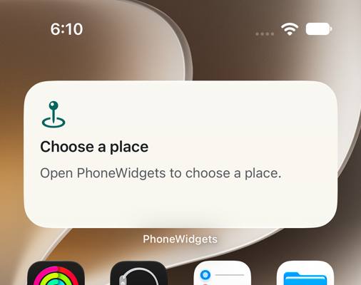 | 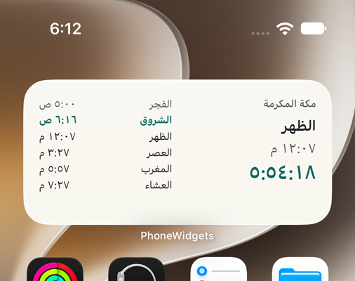 | 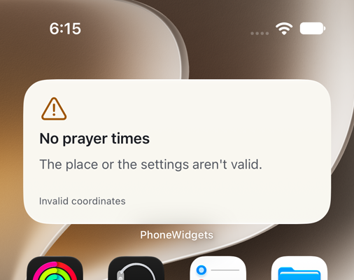 |
| The real extension on the Home Screen after `-cleanStart`: setup required | Arabic names, Arabic-Indic digits and the place's name from the extension, with the simulator in English | Invalid coordinates: no prayer times, and why |
| 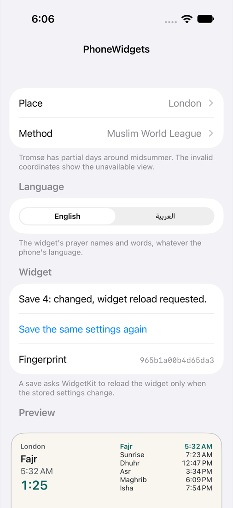 | 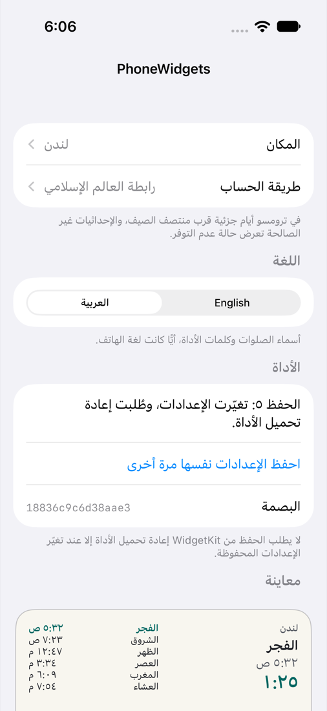 | 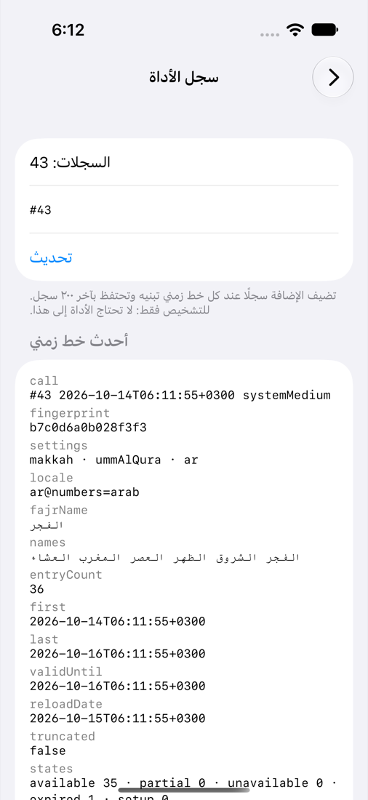 |
| Settings: each save says whether it asked for a reload | The app follows the names' language, right to left | The extension's latest timeline in the Widget log |
| 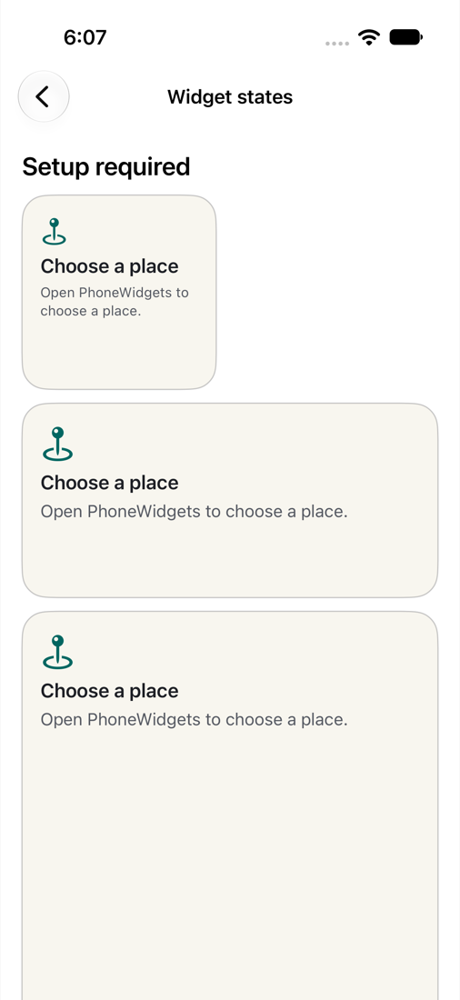 | 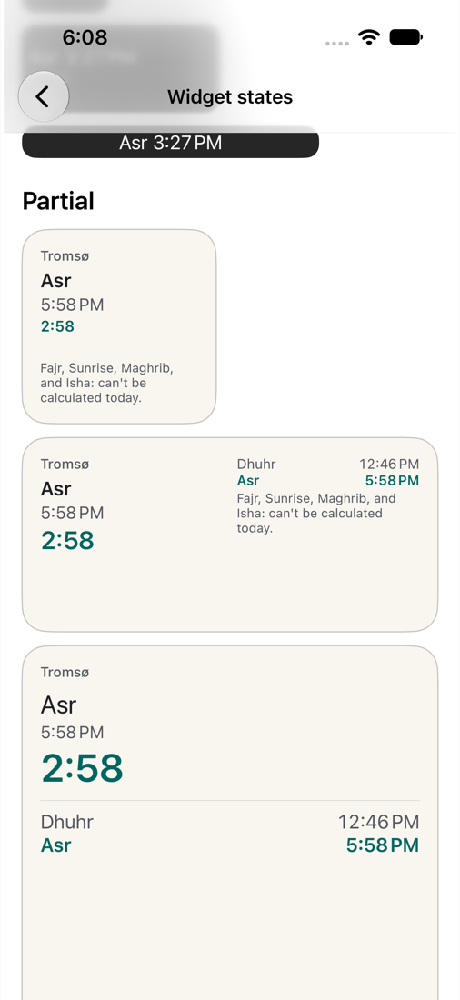 | 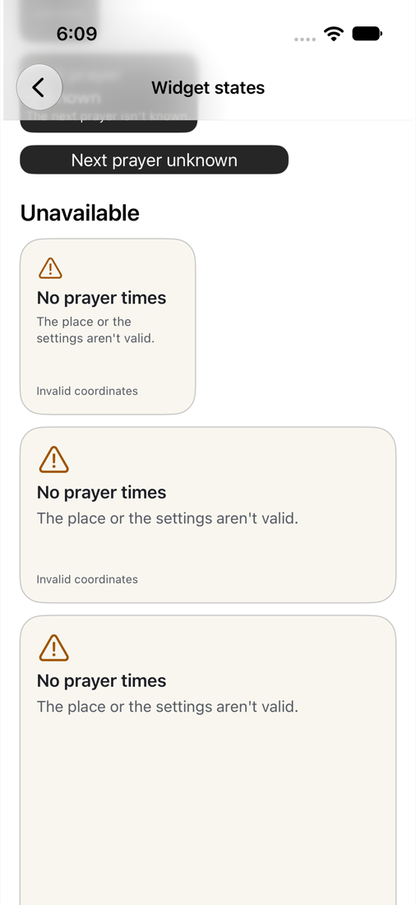 |
| Widget states: setup required and normal | Tromsø's partial day: two known times and a countdown to the known next prayer | Unavailable, in every family |
| 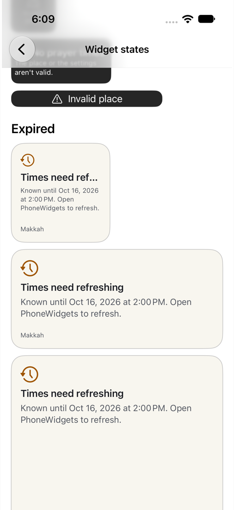 | 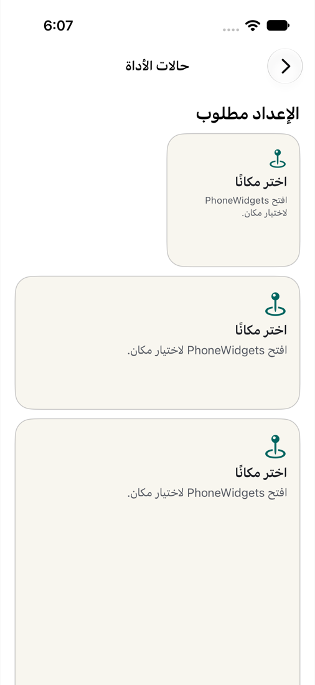 | |
| Expired: the times need refreshing, no countdown | The states in Arabic | |

## App Group and signing

Both targets declare the App Group in their entitlements (`PhoneWidgets/PhoneWidgets.entitlements`, `Widgets/Widgets.entitlements`), generated from `project.yml`. No team is committed.

- **Simulator:** no signing needed. Xcode signs simulator builds ad hoc and embeds the entitlements in the binaries, and the simulator honors the App Group: the app's saved settings reach the extension, as the Home Screen journey shows.
- **Device:** copy `Config/Local.xcconfig.example` to `Config/Local.xcconfig` (gitignored) and set your team. Xcode's automatic signing registers the two bundle identifiers and the App Group. To ship your own app, change the identifiers (`io.github.salah-kit.PhoneWidgets`, `.Widgets`), the App Group in both entitlements and in `PhoneWidgetsID.appGroup`, and the widget kind.

`PrivacyInfo.xcprivacy` in each target declares App Group `UserDefaults` access with reason `1C8F.1`. Neither target uses the standard defaults. The diagnostics log is a file in the App Group container and needs no required-reason API.

## Building and testing

Open `PhoneWidgets.xcodeproj` and run the `PhoneWidgets` scheme on an iPhone simulator. From the command line, in this folder:

```sh
xcodegen                         # after changing project.yml; commit both files
xcodebuild test -project PhoneWidgets.xcodeproj -scheme PhoneWidgets \
  -destination 'platform=iOS Simulator,name=iPhone 17'
# The other default-isolation setting (the project defaults to MainActor):
xcodebuild build-for-testing -project PhoneWidgets.xcodeproj -scheme PhoneWidgets \
  -destination 'generic/platform=iOS Simulator' PHONEWIDGETS_ISOLATION=nonisolated
```

Generate the project from a clone whose folder is named `SalahKit`, as CI's checkout is: XcodeGen names the local package's folder reference after the folder `../..` resolves to.

### Default isolation

The example's targets set `SWIFT_DEFAULT_ACTOR_ISOLATION` to `$(PHONEWIDGETS_ISOLATION)`, which is `MainActor` unless a build passes `PHONEWIDGETS_ISOLATION=nonisolated`. CI builds both. Don't pass `SWIFT_DEFAULT_ACTOR_ISOLATION` itself on the command line: it would reach the package targets too and break SalahCalculation ([RFC 0001](../../docs/rfcs/0001-core.md) §6.3). The shared types (`WidgetSettings`, `PrayerTimelineProvider`, `WidgetDisplay`, `DiagnosticsLog`) and the extension's `Provider` are `nonisolated`, so the timeline is built off the main actor under either setting.

### Launch arguments

| Argument | Effect |
|---|---|
| `-now 2026-10-14T14:00:00+03:00` | Start the app's clock at this ISO 8601 instant (the preview and Widget states). The extension always uses the real clock. |
| `-frozen` | Keep the app's clock at `-now` |
| `-cleanStart` | Remove the stored settings first, as on a fresh install. The widget reloads into its setup prompt. |
| `-place makkah` | `makkah`, `london`, `tromso` or `invalid`; saved |
| `-method ummAlQura` | A `CalculationMethod` raw value; saved |
| `-language ar` | `en` or `ar`; saved |

### Tests

- `PhoneWidgetsTests` (Swift Testing, hosted by the app) tests the example's own code with a fixed clock. A host modeled on SalahWidgets' test host calls `PrayerTimelineProvider` as WidgetKit's documented contract says, at each reload date or when the app asks, and checks every five minutes and around every entry and event that the entry on show says what the schedule says at that instant and lists that instant's day:
  - seven days in Makkah with a reload a day, every prayer in turn and a new day at each midnight;
  - a provider call six hours past a timeline's validity, where the expired entry shows exactly from `validUntil` until the late call, and a call late by less than the slack, where it never shows;
  - no settings at first (setup required, no reload) until the app saves them and asks for a reload;
  - Tromsø's partial midsummer days and invalid coordinates;
  - the state-to-view mapping and the wording of every state in English and Arabic, the settings' JSON and fingerprint, reload gating through `SettingsStore` with a recording `SharedValue`, the launch arguments, the diagnostics log and its 200-record bound, and the palette's `ContrastCheck`.
- `PhoneWidgetsUITests` runs the real app and the real extension:
  - `AppJourneys`: setting up, saving the same settings again ("unchanged"), changing the place, method and language ("reload requested"), a relaunch; launch arguments that apply once (a regression test: the app used to make its store in a view's initializer, which SwiftUI ran again when the language changed, and the discarded store saved the launch arguments over the change; the Home Screen journey found it); and the Widget states screen in English and Arabic, asserting the setup, normal, partial (with a known and an unknown next prayer), unavailable and expired wording, and that an unknown next prayer and an expired timeline show no countdown.
  - `HomeScreenJourney`: adds the medium widget through Springboard and checks the real extension. Hosted CI runners skip it (see below).

## The Home Screen journey

`HomeScreenJourney` drives Springboard as a person does: a long press on empty space, Edit, Add Widget, PhoneWidgets in the list, the medium page, Add Widget, Done. Springboard's accessibility tree exposes the placed widget's text and the identifiers its views set (`widget.title`, `widget.row.fajr`, …), so the journey asserts what the real extension drew. Then it:

1. checks the setup-required view after `-cleanStart`, which leaves the App Group without settings as a fresh install does;
2. sets up Makkah in English, waits for the extension's log record of those settings, and finds "Fajr" on the Home Screen;
3. switches to Arabic in the app while the simulator runs in English, waits for the record, and finds "الفجر" and "مكة المكرمة" on the Home Screen, and "الفجر" in the log: the extension looked the names up with an explicit locale;
4. saves the same settings again and watches the log for 30 seconds: no new record;
5. chooses the invalid coordinates and finds the unavailable view on the Home Screen;
6. attaches the timelines the extension produced and screenshots, and removes the widget.

A changed save must produce its record within 60 seconds.

On an iPhone 17 simulator with iOS 27.0 (Xcode 27.0, an M2 Pro Mac), the journey passed: each changed save produced its record within a few seconds, and the 30-second window after the unchanged save stayed empty.

WidgetKit's reload policy shows up in that run. Its daemon's log (`xcrun simctl spawn <udid> log show --predicate 'process == "chronod"'`) says "Allowing first refresh while foreground" for the first reload the app asks for while it's in the foreground, "Throttling additional refresh request while foreground" for later ones, and runs a held reload when the app goes to the background ("Flushing pending reload request due to background transition") or after about 90 seconds. So the journey goes to the Home Screen after each change it waits for. An app should expect the same: a burst of saves while the user edits settings reaches the widget when they leave the app.

It skips itself when `PHONEWIDGETS_SKIP_HOME_SCREEN=1`, which CI sets: Springboard's editing UI and WidgetKit's timing on a cold hosted simulator aren't something every pull request should depend on. Run it locally:

```sh
xcodebuild test -project PhoneWidgets.xcodeproj -scheme PhoneWidgets \
  -destination 'platform=iOS Simulator,name=iPhone 17' \
  -only-testing:PhoneWidgetsUITests/HomeScreenJourney
```

## The diagnostics log

The extension's evidence channel, kept to one file, `Shared/Diagnostics.swift`, and clearly marked: a widget built on this example doesn't need it. On every `getTimeline` the extension appends a record to `diagnostics.v1.json` in the App Group container (the last 200, written atomically; the extension is its only writer) and writes the same line to the unified log (subsystem `io.github.salah-kit.PhoneWidgets`, category `timeline`). Each record holds:

- the call's sequence number, date and family;
- the fingerprint of the settings the extension read (a 64-bit FNV-1a hash of their JSON, shown in the app too) or `none`, and a summary such as `makkah · ummAlQura · ar`;
- the locale it looked the names up in and the names it resolved, Fajr through Isha;
- the number of entries, the first and last entry dates, `validUntil`, `reloadDate`, `isTruncated`, a count of the entries' states and each entry in words (`2026-10-14 15:27 next maghrib@17:57`);
- the time the provider took (`ContinuousClock`) and the extension's memory footprint (`task_info` `TASK_VM_INFO` `phys_footprint`) before and after.

The app's Widget log screen shows the latest record in full, the earlier ones folded, and every record on one line, refreshed every two seconds. From a Mac, the unified log works too:

```sh
xcrun simctl spawn booted log show --last 1h \
  --predicate 'subsystem == "io.github.salah-kit.PhoneWidgets"'
```

### Measured cost

Measured inside the real extension on an iPhone 17 simulator with iOS 27.0 (Xcode 27.0, an Apple M2 Pro Mac shared with other builds), from the 45 records the journeys' runs left in the log (the `extension-log` attachment of the Home Screen journey):

| | Calls | Generation time | Footprint |
|---|---|---|---|
| A 48-hour calculated timeline (36 entries) | 34 | 4.7 ms minimum, 7.5 ms median, 20 ms at the 90th percentile, 125 ms at most | 7.4 to 18.5 MiB; one timeline adds at most 144 KiB |
| Invalid coordinates (6 entries) | 2 | 1.7 and 3.7 ms | about 18.3 MiB |
| Setup required (1 entry) | 9 | under 1 ms | |

A later run measured 356 ms for the first call after the extension started cold, then 6.4 to 59 ms, at 14.7 to 18.1 MiB.

The time is the provider's work alone (`ContinuousClock` around `PrayerTimelineProvider.timeline`); the footprint is `phys_footprint` before and after it, so it includes SwiftUI and WidgetKit, which the extension loads anyway. A simulator on a Mac says little about the oldest supported iPhone; that measurement is pending.

## Accessibility and languages

Every control has a VoiceOver label, and every widget family names the next prayer in full for VoiceOver, the circular one too (a journey checks it on the Widget states screen). Text uses Dynamic Type styles, and Arabic lays the app and the widget out right to left with Arabic-Indic digits. The Home Screen colors (`WidgetPalette`, light and dark) pass SalahUI's `ContrastCheck`: 4.5:1 for text, 3:1 for the problem symbols, and the accent stays clear of the system's alert red; a unit test checks them. Lock Screen widgets use the system's tint. UI strings are in `Shared/Localizable.xcstrings` in English and Arabic; the Arabic strings are machine-drafted and marked as needing review.

## Pending

- **The seven-day iPhone soak** (proposal §7.3): install on an iPhone, add the widgets, don't open the app for seven days, then read the Widget log.
- **The oldest supported iPhone:** measure the generation time and memory there.
- **A real Lock Screen:** the accessory families are checked in the Widget states screen only.
- **Arabic review:** a native speaker should review the Arabic strings.
