# WatchComplication

A minimal Apple Watch app with a complication, and a companion iPhone app that sends it its inputs over WatchConnectivity. The watch keeps its own copy of the inputs and builds its schedule from them: with the iPhone app closed, the watch app and the complication keep showing the next prayer and its countdown.

WatchComplication is SalahKit's watch example (proposal §5.3 and §11). It uses only the public API of `SalahCore`, `SalahCalculation`, `SalahWidgets` and `SalahUI`. It shows what a watch must handle: inputs that haven't arrived yet, a later change from the iPhone, operation from the last valid inputs while the iPhone app is closed, and a published timetable that runs out.

## Processes

| Process | Target | What it does |
|---|---|---|
| Companion (iPhone) | `WatchComplication` | Picks a preset and sends it with `WCSession.updateApplicationContext(_:)`; shows the session's state and what it sent |
| Watch app | `WatchComplicationWatch` | Receives the inputs, stores them with `SharedValue` in the watch's App Group, reloads the complication when they change, and shows the current state |
| Complication | `Complications` (watchOS WidgetKit extension) | Reads the inputs from the watch's App Group and builds its timeline with `PrayerTimelineBuilder` |

A watch app doesn't share App Group storage with its iPhone app (proposal §5.3), so the watch keeps its own copy. The App Group `group.io.github.salah-kit.WatchComplication` belongs to the watch app and its complication only. The companion never writes to it; it can only send.

**Why an application context.** The watch needs only the latest inputs. `updateApplicationContext(_:)` keeps one context: a newer one replaces a context the watch hasn't received yet, and the system delivers it when the watch app next runs, whether or not the companion is still running. `transferUserInfo(_:)` would queue every send and deliver stale inputs first. The context also persists on both sides (`applicationContext`, `receivedApplicationContext`), so the companion shows what the watch gets next even after it relaunches, and the watch app reads the last context again once its session is active, in case a delivery was missed. Delivery timing isn't guaranteed: the watch works from what it has until new inputs arrive.

**The receive-and-store path** (`InputsReceiver`): the context holds the inputs as JSON data under the versioned key `inputs.v1`, and the send time. The watch decodes them, saves them with `SharedValue.save(_:reloading:)` under the versioned key `inputs.v1`, and records a receipt. `SharedValue` reloads the complication only when the stored inputs changed: sending the same inputs again writes a new receipt ("unchanged") and costs no reload. A context that doesn't decode is rejected, and the watch keeps its last valid inputs. When the system wakes the watch app in the background to deliver a context, `.backgroundTask(.watchConnectivity)` gives the delegate time to store it.

## Inputs

`WatchInputs` (`Shared/WatchInputs.swift`) is `Codable`, `Equatable` and `Sendable`: the place (`PrayerLocation`, with its time zone) and the source, either `CalculationSettings` (times calculated on the watch, which never run out) or a published `TimetableSource` (a few days of rows, which do).

| Preset (`-preset`) | Source | What the watch shows |
|---|---|---|
| `makkah` (default) | Makkah, calculated with Umm al-Qura | The next prayer and its live countdown, indefinitely |
| `mosque` | The Sample Mosque's timetable: three days of rows from today | The next prayer until the last row's Isha, then the latest prayer with an unknown next one, then the ended-timetable view |
| `mosqueEnded` | The same timetable, whose last row was yesterday | The ended-timetable view: "Timetable ended", asking for new times from the iPhone |

The Sample Mosque is made up. Its rows are published as a mosque would publish them, as local wall-clock times in `Europe/London`, but the times come from a Muslim World League calculation for its coordinates, rounded to the minute.

## Complication

One widget, `PrayerComplication`, in four accessory families: `accessoryCircular`, `accessoryRectangular`, `accessoryInline` and `accessoryCorner`. The views (`WatchShared/ComplicationViews.swift`) are SalahUI's `NextPrayerView` with a `NextPrayerStyle` per family, and messages for the states without a next prayer. The countdown is SalahUI's live countdown, a `Text(timerInterval:)` that the system keeps running, so the timeline needs an entry only where the state changes.

| State | When | Wording | What fixes it |
|---|---|---|---|
| Missing settings | No inputs stored yet | "No settings yet", "Open the iPhone app" | Inputs from the iPhone; the watch app reloads the complication when they arrive |
| Next prayer | The schedule knows the next prayer | Its name, time and live countdown, and the place | |
| Partial | The latest prayer is known, the next isn't (after a timetable's last Isha) | "Latest: Isha 7:49 PM", "Next prayer unknown · Send new times from the iPhone" | New published times |
| Timetable ended | `.schedule(.unavailable)` with a `noPublishedData` gap: the timetable is past its last row | "Timetable ended", "Send new times from the iPhone" | New published times from the iPhone. A reload can't fix it |
| Times unavailable | Another source gap, such as coordinates no calculation accepts | "Times unavailable" and the reason | Correct inputs |
| Timeline expired | `.expired(knownThrough:)`: WidgetKit didn't ask for a new timeline in time | "Times need refreshing", "Known through 2:00 PM" | The next timeline. The source may be fine |

The two "no times" states are worded apart on purpose: an ended timetable needs new data from the iPhone, and an expired timeline needs only a reload.

The timeline (`ComplicationTimeline.make(inputs:now:)`) is SalahWidgets' `PrayerTimelineBuilder.timeline(from:horizon:entry:)`: an entry wherever the state changes over 48 hours, the timeline-expired entry at the end, and a reload halfway. Without inputs it's one setup entry with the policy `.never`: the watch app reloads the complication when inputs arrive.

The watch app's **Complication states** screen draws every state in every family with the same views, from real inputs at fixed instants, and the current entry from the stored inputs. The UI tests assert the states there, in the running app, because a watch face can't be inspected from a test.

## Screenshots

These are the journeys' screenshot attachments, exported from test runs on an Apple Watch Series 11 (46 mm) simulator with watchOS 27, paired with an iPhone 17 simulator with iOS 27 (`xcrun xcresulttool export attachments`), and scaled down. The first seven come from the paired journey.

| | | |
|---|---|---|
| 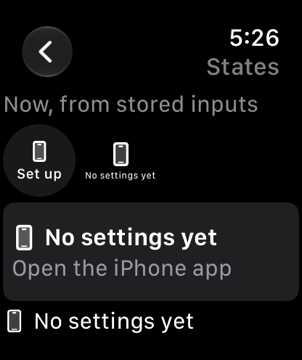 | 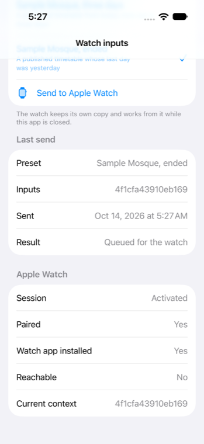 | 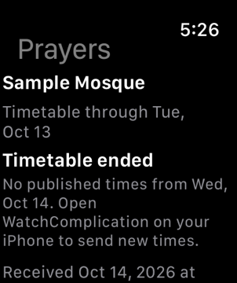 |
| A fresh watch app: no inputs yet | The companion sent the ended timetable: queued, paired, watch app installed | The watch received it: the timetable ended, new times must come from the iPhone |
| 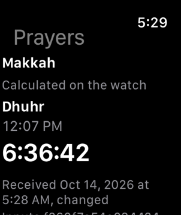 | 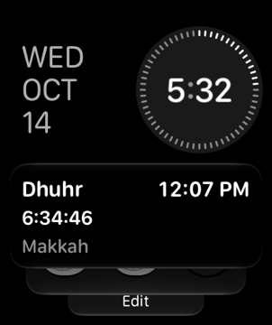 | 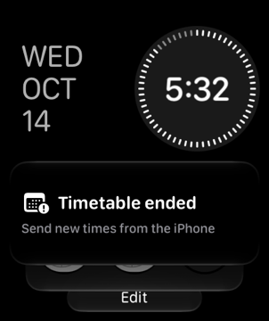 |
| The companion terminated: a new launch shows Makkah's next prayer from the watch's storage | The complication in the Smart Stack: Dhuhr, its time and live countdown | The complication after the watch app stored the ended timetable |
| 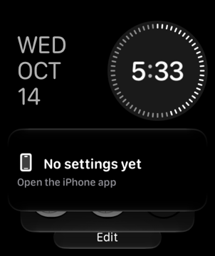 |  | 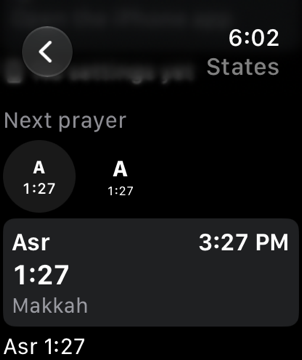 |
| The complication after the watch app removed its inputs | Complication states: every family with no inputs | Makkah at 14:00, a static countdown for the fixed clock |
| 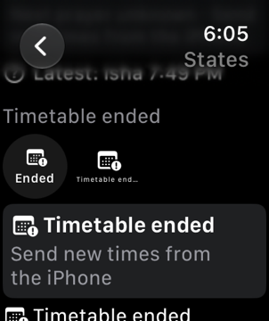 | 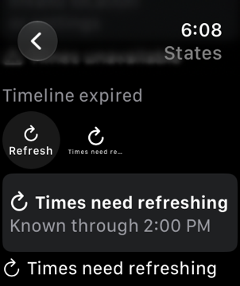 | 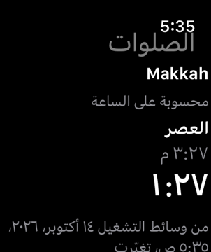 |
| The ended timetable in every family | The timeline-expired entry, worded apart from the ended timetable | Arabic: names, Arabic-Indic digits, right to left |

## Diagnostics

The complication extension appends a record of each `getTimeline` call to the watch's App Group (`TimelineLog`, the latest 50): when it was asked, the family, the inputs' fingerprint or `none`, the entry count, the first and last entries' dates, where the timeline's validity ends, how many entries show each state, how long building took and the extension's memory footprint. It also logs each record with `os.Logger`, subsystem `io.github.salah-kit.WatchComplication`, category `timeline`. The watch app's **Diagnostics** screen lists the records and can ask WidgetKit to reload the complication. The watch app (category `watch`) and the companion (category `companion`) log what they store and send.

```sh
xcrun simctl spawn <watch UDID> log show --last 1h --style compact \
  --predicate 'subsystem == "io.github.salah-kit.WatchComplication"'
```

This is the example's evidence channel, not something a prayer app needs.

## Building and running

Open `WatchComplication.xcodeproj` and run the `WatchComplicationWatch` scheme on a paired Apple Watch simulator, or the `WatchComplication` scheme on its iPhone. Simulator builds need no signing: Xcode signs them ad hoc and embeds the App Group entitlement for the simulator.

To run on devices, copy `Config/Local.xcconfig.example` to `Config/Local.xcconfig` and set your team there; it's gitignored. Then register the App Group `group.io.github.salah-kit.WatchComplication` for the watch app (`io.github.salah-kit.WatchComplication.watchkitapp`) and its extension (`io.github.salah-kit.WatchComplication.watchkitapp.Complications`); Xcode's automatic signing does it with your team. The companion (`io.github.salah-kit.WatchComplication`) needs no App Group.

From the command line, in this folder:

```sh
xcodegen                         # after changing project.yml; commit both files
# The watch's unit tests and journeys, on an Apple Watch simulator:
xcodebuild test -project WatchComplication.xcodeproj -scheme WatchComplicationWatch \
  -destination 'platform=watchOS Simulator,name=Apple Watch Series 11 (46mm)'
# The companion's journey, on an iPhone simulator:
xcodebuild test -project WatchComplication.xcodeproj -scheme WatchComplication \
  -destination 'platform=iOS Simulator,name=iPhone 17'
# The other default-isolation setting (the project defaults to MainActor):
xcodebuild build-for-testing -project WatchComplication.xcodeproj -scheme WatchComplicationWatch \
  -destination 'generic/platform=watchOS Simulator' WATCHCOMPLICATION_ISOLATION=nonisolated
```

Generate the project from a clone whose folder is named `SalahKit`, as CI's checkout is: XcodeGen names the local package's folder reference after the folder `../..` resolves to.

### Default isolation

Every target sets `SWIFT_DEFAULT_ACTOR_ISOLATION` to `$(WATCHCOMPLICATION_ISOLATION)`, which is `MainActor` unless a build passes `WATCHCOMPLICATION_ISOLATION=nonisolated`. CI builds both. Don't pass `SWIFT_DEFAULT_ACTOR_ISOLATION` itself on the command line: it would reach the package targets too and break SalahCalculation ([RFC 0001](../../docs/rfcs/0001-core.md) §6.3).

Under `MainActor` default isolation, the types that cross processes or threads are declared `nonisolated`: the inputs and their message, the `SharedValue` extensions, the timeline provider and its entry, and the WatchConnectivity delegates, whose callbacks arrive on WatchConnectivity's queue. The models are `@MainActor`.

### Launch arguments

`LaunchOptions` reads these.

| Argument | Effect |
|---|---|
| `-now 2026-10-14T14:00:00+03:00` | Show this instant, with the clock stopped there; countdowns show the time left at it |
| `-language en` or `-language ar` | UI strings, prayer names and digits. Add `-AppleLanguages (ar)` for the system's own right-to-left behavior |
| `-preset makkah` | Companion: select a preset. Watch: store it through the receive path, as if the iPhone had sent it |
| `-send` | Companion: send the selected preset once the session is active |
| `-resetInputs` | Watch: start with no stored inputs, as a fresh install does |
| `-screen states` or `-screen diagnostics` | Watch: open that screen at launch |

## Tests

- `WatchComplicationTests` (Swift Testing, hosted by the watch app) tests the logic below the UI with a fixed clock:
  - missing inputs give one setup entry with the policy `.never`;
  - a calculated source gives next-prayer entries over 48 hours ending with the timeline-expired entry, and a reload after 24 hours, the same timeline as SalahWidgets' own;
  - a timetable that ends: the last row's prayers, the latest prayer with an unknown next one after its Isha, and from midnight a `.schedule(.unavailable)` state with `noPublishedData`, shown as the ended-timetable view and never as the timeline-expired view; the expired entry is never shown as the ended timetable;
  - other gaps, every sample on the states screen, the diagnostics record and its bounded log;
  - the inputs' JSON round trip and fingerprints, the application context, the presets and the launch arguments;
  - the receive-and-store path through `SharedValue` with an injected reloader: the first inputs reload, the same inputs again don't, a repeated send is ignored, different inputs reload, a broken context keeps the last valid inputs, and a reset reloads.
- `WatchUITests` runs the real watch app on a watch simulator, with no iPhone: the missing-settings view on a fresh start; the states screen with every state in every family; stored inputs shown again by a later launch; the ended timetable; Arabic.
- `CompanionUITests` runs the companion: presets, a send and the session's state. Unpaired, WatchConnectivity refuses the send and the app says why.

### The paired journey

`Scripts/paired-journeys.sh` runs the watch's and the companion's XCUITest steps in order on a paired pair of simulators, one `xcodebuild test-without-building` at a time:

1. a fresh watch app shows the missing-settings view, on the home screen and the states screen;
2. the companion sends the timetable that ended yesterday;
3. the watch app receives and stores it, and shows the ended-timetable view;
4. the companion sends Makkah;
5. the watch app receives and stores it, and shows the next prayer;
6. the script terminates the companion and checks that it isn't running;
7. a new launch of the watch app shows Makkah's schedule from its own storage;
8. the watch adds the example's widget to the Smart Stack, which makes WidgetKit run the complication extension;
9. the watch app stores the ended timetable (`-preset mosqueEnded`) and reloads the complication;
10. the watch app removes its inputs (`-resetInputs`) and reloads the complication;
11. the script reads the complication's timeline log from the watch's App Group and fails unless the extension built, after the companion closed, a timeline from the Makkah inputs the companion sent, one with the ended-timetable state and one with the setup state; it also collects both simulators' logs.

Steps 8 to 10 drive the watch's home app (`com.apple.Carousel`): from the face, a turn of the crown opens the Smart Stack, and its Edit button and add slot open the widget gallery, where the example is listed. The home app exposes no accessibility elements there, so the steps tap coordinates measured on an Apple Watch Series 11 (46 mm) with watchOS 27; another watch or system may need new ones. A complication on a watch face would work the same way, but the simulator's default face (Numerals Duo) has no complication slots.

The steps skip unless `WATCHCOMPLICATION_PAIRED=1` reaches the test runner, which the script arranges, so the schemes' ordinary test runs skip them.

```sh
iphone=$(xcrun simctl create WC-iPhone com.apple.CoreSimulator.SimDeviceType.iPhone-17 \
  com.apple.CoreSimulator.SimRuntime.iOS-27-0)
watch=$(xcrun simctl create WC-Watch com.apple.CoreSimulator.SimDeviceType.Apple-Watch-Series-11-46mm \
  com.apple.CoreSimulator.SimRuntime.watchOS-27-0)
pair=$(xcrun simctl pair "$watch" "$iphone")
Scripts/paired-journeys.sh "$iphone" "$watch"
# Afterwards:
xcrun simctl unpair "$pair"; xcrun simctl delete "$watch" "$iphone"
```

CI runs the watch's unit tests and the companion's journey. It doesn't run the watch journeys, which timed out launching the app on hosted runners' watch simulators, or the paired journey (see the workflow's comments); run them locally as above.

### What the simulators showed

On a paired iPhone 17 and Apple Watch Series 11 (46 mm) simulator pair with iOS 27 and watchOS 27, the paired journey passed every step:

- WatchConnectivity delivered each application context within seconds of the send, while the watch app ran.
- With the companion terminated, a new launch of the watch app showed Makkah's next prayer and its live countdown from the watch's storage.
- The complication extension didn't run until its widget was in the Smart Stack: installing the app and asking WidgetKit to reload only made it cache placeholders. Once the widget was in the Smart Stack, every change of the stored inputs reloaded it, and each `getTimeline` call read the watch's App Group, which shows the App Group is shared by the watch app and its extension on the simulator. A widget left in the Smart Stack stayed there when the app was uninstalled and reinstalled.
- The extension built its timelines in under 30 ms, with a memory footprint of 12 to 15 MB: 34 entries for Makkah over 48 hours, 4 for the ended timetable.

The simulator was heavily loaded by other builds during these runs. Watch UI queries then took minutes, so the journeys wait generously and relaunch the app once if it doesn't come up.

## Accessibility and languages

Every complication family reads as one VoiceOver element. For the next prayer, the rectangular family reads its name, time, time remaining and the place; the circular, corner and inline families read its name and the time remaining. The compact families show the abbreviation, such as "A", and VoiceOver reads the full name, "Asr", which SalahUI's `NextPrayerConfiguration.abbreviation` carries as its label. The corner family's element is the prayer's name with the time remaining as its value, because the curved label isn't a child it could combine. Messages read their title and detail. The watch app's text uses Dynamic Type styles and scrolls; the complications use the sizes their families allow. Colors are the system's, with states also told apart by symbols and wording. UI strings are in `Shared/Localizable.xcstrings` in English and Arabic; the Arabic strings are machine-drafted and marked as needing review. Prayer names come from SalahCore in the same locale.

## Pending

- **A real Apple Watch:** only simulators have run the example. Install it on an iPhone and a paired Apple Watch, add the complication to a face and to the Smart Stack, send inputs, close the iPhone app, and record what the watch shows over a day, including the ended timetable and delivery while the watch app isn't running.
- **Contrast check:** the example uses system colors; check them with SalahUI's `ContrastCheck` if it gets custom ones.
- **Arabic review:** a native speaker should review the Arabic strings.
